```mermaid
erDiagram
    %% ============================================
    %% SilverCart Database Entity Relationship Diagram
    %% Total: 13 Tables
    %% ============================================
    
    USERS ||--o{ CART_ITEMS : "has cart"
    USERS ||--o{ ORDERS : "places orders"
    USERS ||--|| APP_SETTINGS : "has settings"
    USERS ||--|| PROFILES : "has profile"
    USERS ||--o{ SUPPORT_MESSAGES : "creates tickets"
    USERS ||--o{ NOTIFICATIONS : "receives"
    
    PRODUCTS ||--o{ CART_ITEMS : "in carts"
    PRODUCTS ||--o{ ORDER_ITEMS : "in orders"
    
    ORDERS ||--o{ ORDER_ITEMS : "contains items"
    ORDERS ||--o{ ORDER_STATUS_HISTORY : "has history"
    ORDERS ||--o{ NOTIFICATIONS : "triggers"
    
    SUPPORT_MESSAGES ||--o{ SUPPORT_REPLIES : "has replies"
    SUPPORT_MESSAGES }o--|| ADMINS : "assigned to"
    SUPPORT_MESSAGES }o--|| ADMINS : "resolved by"
    
    ADMINS ||--o{ ADMIN_ACTIVITY_LOG : "performs actions"
    
    %% ============================================
    %% TABLE DEFINITIONS
    %% ============================================
    
    USERS {
        uuid id PK "Primary Key"
        varchar email UK "Unique, nullable"
        varchar phone_number UK "Unique, nullable"
        varchar name "Required"
        text address "Delivery address"
        boolean biometric_enabled "Face/Touch ID"
        varchar auth_method "email or phone"
        varchar trusted_contact_name "Family member"
        varchar trusted_contact_phone "Family phone"
        varchar trusted_contact_relationship "son/daughter/spouse"
        boolean trusted_contact_enabled
        boolean trusted_contact_notify_orders
        boolean trusted_contact_notify_security
        timestamp created_at
        timestamp updated_at
    }
    
    PROFILES {
        uuid id PK "Matches auth.users(id)"
        varchar phone "Nullable"
        varchar role "user"
        timestamp created_at
        timestamp updated_at
    }
    
    APP_SETTINGS {
        uuid id PK
        uuid user_id FK "References users"
        varchar language "en or ms"
        boolean push_notifications_enabled
        boolean email_notifications_enabled
        boolean sms_notifications_enabled
        varchar text_size "small/medium/large/xl"
        boolean high_contrast_mode
        boolean voice_feedback_enabled
        timestamp created_at
        timestamp updated_at
    }
    
    PRODUCTS {
        uuid id PK
        varchar name "Required"
        varchar category "pharmacy or grocery"
        text description
        decimal price "Must be >= 0"
        text image_url
        varchar stock_status "in_stock or out_of_stock"
        text_array search_keywords "Voice search terms"
        timestamp created_at
        timestamp updated_at
    }
    
    CART_ITEMS {
        uuid id PK
        uuid user_id FK "References users"
        uuid product_id FK "References products"
        integer quantity "Must be > 0"
        timestamp created_at
        timestamp updated_at
    }
    
    ORDERS {
        uuid id PK
        uuid user_id FK "References users"
        decimal total_amount "Must be >= 0"
        decimal subtotal "Must be >= 0"
        decimal delivery_fee "Default 5.00"
        text delivery_address "Required"
        varchar payment_method "cod/online_banking/e_wallet"
        varchar status "pending/confirmed/preparing/delivering/delivered/cancelled"
        timestamp estimated_delivery
        timestamp delivered_at
        timestamp cancelled_at
        text cancellation_reason
        varchar cancelled_by "customer or admin"
        timestamp created_at
        timestamp updated_at
    }
    
    ORDER_ITEMS {
        uuid id PK
        uuid order_id FK "References orders"
        uuid product_id FK "References products"
        integer quantity "Must be > 0"
        decimal price_at_purchase "Price when ordered"
        timestamp created_at
    }
    
    ORDER_STATUS_HISTORY {
        uuid id PK
        uuid order_id FK "References orders"
        varchar from_status "Previous status"
        varchar to_status "New status"
        varchar changed_by_type "customer/admin/system"
        uuid changed_by_id "User or admin ID"
        text note "Optional reason"
        timestamp created_at
    }
    
    NOTIFICATIONS {
        uuid id PK
        uuid user_id FK "References users"
        uuid order_id FK "References orders"
        varchar type "order_placed/confirmed/delivered/security_alert"
        text message "SMS content"
        varchar recipient_type "customer or trusted_contact"
        varchar recipient_phone "Phone to send to"
        boolean sent "Delivery status"
        timestamp sent_at
        timestamp created_at
    }
    
    SUPPORT_MESSAGES {
        uuid id PK
        uuid user_id FK "References users"
        uuid order_id FK "References orders, nullable"
        varchar subject
        text message "Required"
        varchar status "open/in_progress/resolved"
        varchar priority "low/normal/high"
        boolean is_read
        uuid assigned_to FK "References admins"
        uuid resolved_by FK "References admins"
        timestamp resolved_at
        timestamp created_at
        timestamp updated_at
    }
    
    SUPPORT_REPLIES {
        uuid id PK
        uuid support_message_id FK "References support_messages"
        varchar sender_type "customer or admin"
        uuid sender_id "User or admin ID"
        text message "Required"
        boolean is_read
        timestamp created_at
    }
    
    ADMINS {
        uuid id PK
        varchar email UK "Unique, required"
        varchar password_hash "Bcrypt hash"
        varchar name
        varchar role "admin/support/manager"
        timestamp last_login
        timestamp created_at
    }
    
    ADMIN_ACTIVITY_LOG {
        uuid id PK
        uuid admin_id FK "References admins"
        varchar action_type "product_created/order_updated/etc"
        varchar entity_type "product/order/support_message"
        uuid entity_id "ID of affected entity"
        text description
        jsonb metadata "Additional data"
        timestamp created_at
    }
```

---

## Database Statistics

**Total Tables:** 13  
**Total Columns:** ~125  
**Foreign Keys:** 16  
**Indexes:** 26+  
**RLS Policies:** 18+  
**Triggers:** 7 (auto-update timestamps)

---

## Key Features

### 🔐 Security
- Row Level Security (RLS) on all user-facing tables
- Users can only see their own data
- Admin-only access to sensitive operations

### ⚡ Performance
- Indexes on all foreign keys
- GIN indexes for full-text search
- Indexes on frequently queried columns

### 🛡️ Data Integrity
- Foreign key constraints
- Check constraints (positive prices, quantities)
- Unique constraints (prevent duplicates)
- NOT NULL constraints on required fields

### 📊 Audit Trail
- `order_status_history` tracks all order changes
- `admin_activity_log` tracks all admin actions
- Automatic timestamp updates

---

## Common Queries

### Get User's Cart with Product Details
```sql
SELECT 
  ci.id,
  ci.quantity,
  p.name,
  p.price,
  (ci.quantity * p.price) as subtotal
FROM cart_items ci
JOIN products p ON ci.product_id = p.id
WHERE ci.user_id = 'user-id-here';
```

### Get Order with Items
```sql
SELECT 
  o.*,
  json_agg(
    json_build_object(
      'product_name', p.name,
      'quantity', oi.quantity,
      'price', oi.price_at_purchase
    )
  ) as items
FROM orders o
JOIN order_items oi ON o.id = oi.order_id
JOIN products p ON oi.product_id = p.id
WHERE o.id = 'order-id-here'
GROUP BY o.id;
```

### Get Order Status Timeline
```sql
SELECT 
  from_status,
  to_status,
  changed_by_type,
  note,
  created_at
FROM order_status_history
WHERE order_id = 'order-id-here'
ORDER BY created_at ASC;
```
