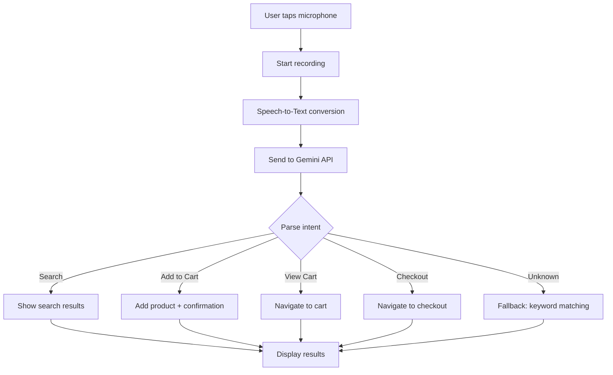

# SilverCart - AI Build Documentation Summary
**Version:** 2.0 - Updated January 2026  
**Purpose:** Complete reference for AI-assisted development  
**Total Screens:** 46 (37 Mobile + 9 Admin)  
**Timeline:** 16 weeks (Jan 16 - May 8, 2026)  
**Type:** Final Year Project (Individual)

---

## 🎯 PROJECT OVERVIEW

### What We're Building
**SilverCart** is a voice-enabled mobile e-commerce application specifically designed for elderly Malaysians (60+). It operates as a **single-store direct retail platform** (like Guardian Pharmacy or Tesco Grocery apps), selling pharmacy items and groceries directly to customers.

### Key Differentiators
- **Voice-first shopping** with Google Gemini AI integration
- **Elderly-optimized UI** (large fonts, high contrast, simple navigation)
- **Trust & safety features** (trusted contact notifications, scam prevention)
- **Single-store model** (NOT a marketplace like Shopee/Lazada)
- **Comprehensive admin system** with order management and support

---

## 📊 SCREEN INVENTORY (46 SCREENS)

### MOBILE APP: 37 SCREENS

#### A. Authentication Flow (12 screens)
| Screen | Route | Key Purpose |
|--------|-------|-------------|
| **A1** | `/welcome` | First screen, sign-up options (email/phone) |
| **A2** | `/auth/register-email` | Email registration with password |
| **A2a** | `/auth/verify-email` | Email verification (6-digit code) |
| **A3** | `/auth/register-phone` | Phone registration (+60 prefix) |
| **A3a** | `/auth/verify-otp` | OTP verification (6-digit boxes) |
| **A3b** | `/auth/set-password` | Set password after phone verification |
| **A4** | `/auth/login` | Login with email/phone (tabbed interface) |
| **A4a** | `/auth/forgot-password` | Password reset via email |
| **A5** | `/auth/profile-setup` | First-time profile (name + address) |
| **A6** | `/auth/trusted-contact-setup` | Add family member for notifications |
| **A7** | `/auth/biometric-setup` | Enable Face ID/Touch ID/Fingerprint |
| **A8** | `/onboarding` | 3-slide tutorial (voice search, large UI, easy checkout) |

#### B. Main App - Bottom Tabs (4 screens)
| Screen | Route | Tab Icon | Key Purpose |
|--------|-------|----------|-------------|
| **B1** | `/home` | 🏠 Home | Voice search button, category cards, featured products |
| **B2** | `/cart` | 🛒 Cart | Cart items, quantity controls, checkout button |
| **B3** | `/orders` | 📋 Orders | Order history, reorder functionality |
| **B4** | `/profile` | 👤 Profile | Account menu, settings, logout |

#### C. Voice Search (1 screen)
| Screen | Route | Key Purpose |
|--------|-------|-------------|
| **C1** | `/voice-search` | Active voice recording, waveform animation, speech-to-text display |

#### D. Product Browsing (2 screens)
| Screen | Route | Key Purpose |
|--------|-------|-------------|
| **D1** | `/category/:categoryId` | Product grid (2 columns), sub-categories, Add to Cart |
| **D2** | `/search?q=[query]` | Search results from voice/text input |

#### E. Product Detail (1 screen)
| Screen | Route | Key Purpose |
|--------|-------|-------------|
| **E1** | `/product/:productId` | Large image, price (32pt), quantity selector, Add to Cart |

#### F. Checkout Flow (4 screens)
| Screen | Route | Progress | Key Purpose |
|--------|-------|----------|-------------|
| **G1** | `/checkout/step1` | ● ○ ○ | Delivery address confirmation |
| **G2** | `/checkout/step2` | ● ● ○ | Payment method (COD default, recommended) |
| **G3** | `/checkout/step3` | ● ● ● | Order review, confirmation checkbox |
| **G4** | `/checkout/confirmation` | Complete | Order number, SMS to user + trusted contact |

#### H. Order Management (1 screen)
| Screen | Route | Key Purpose |
|--------|-------|-------------|
| **H1** | `/order/:orderId` | Order details, status, items list, Reorder button |

#### I. Profile & Settings (9 screens)
| Screen | Route | Key Purpose |
|--------|-------|-------------|
| **I2** | `/profile/trusted-contact` | Manage trusted contact (family member) |
| **I2a** | `/profile/trusted-contact/edit` | Add/edit trusted contact form |
| **I3** | `/profile/edit` | Edit name, address (email/phone read-only) |
| **I4** | `/profile/security` | Biometric toggle, change password, 2FA (Phase 2) |
| **I4a** | `/profile/security/change-password` | Change password form |
| **I5** | `/profile/support` | Contact support (Call, WhatsApp, Email, FAQ) |
| **I6** | `/order/:orderId/cancel` | **NEW** - Cancel order (5-min countdown timer) |
| **I7** | `/profile/settings` | **NEW** - Language, notifications, accessibility, data |
| **I8** | `/profile/addresses` | **FUTURE** - Multiple addresses (Phase 2) |

#### J. Special Screens (3 screens)
| Screen | Route | Key Purpose |
|--------|-------|-------------|
| **J1** | `/safety-tutorial` | 4-slide safety education (scam prevention) |
| **J2** | System native | Biometric authentication prompt |
| **J3** | `/error` or modal | Error states (offline, 404, server error) |

---

### ADMIN PANEL: 9 SCREENS

#### AA. Login (1 screen)
| Screen | URL | Key Purpose |
|--------|-----|-------------|
| **AA1** | `/admin/login` | Admin authentication (hardcoded: admin@silvercart.com / Admin123!) |

#### AB. Product Management (4 screens)
| Screen | URL | Key Purpose |
|--------|-----|-------------|
| **AA2** | `/admin/products` | Products table, search, filter, pagination (10/page) |
| **AA3** | `/admin/products/add` | Add new product form (name, category, price, image URL, keywords) |
| **AA4** | `/admin/products/edit/:id` | Edit product form (pre-filled) |
| **AA5** | Modal | Delete product confirmation dialog |

#### AC. Order Management (2 screens) ← **NEW**
| Screen | URL | Key Purpose |
|--------|-----|-------------|
| **AA6** | `/admin/orders` | Order dashboard, filters (status, date), search, export CSV |
| **AA7** | `/admin/orders/:id` | Order detail, status updates, customer info, internal notes |

#### AD. Support System (1 screen) ← **NEW**
| Screen | URL | Key Purpose |
|--------|-----|-------------|
| **AA8** | `/admin/support` | Split-pane inbox, customer chat, quick responses, mark resolved |

#### AE. Dashboard (1 screen) ← **NEW**
| Screen | URL | Key Purpose |
|--------|-----|-------------|
| **AA9** | `/admin/dashboard` | Metrics (orders, revenue), recent activity, alerts, quick actions |

---

## 🏗️ TECHNICAL ARCHITECTURE

### Technology Stack

#### Frontend (Mobile App)
```yaml
Framework: React Native with Expo
Language: JavaScript/TypeScript
UI Library: React Native Paper (Material Design)
Navigation: React Navigation
State Management: React Context API / Zustand
Voice Recognition: expo-speech / react-native-voice
HTTP Client: Axios
Form Validation: Formik + Yup
```

#### Frontend (Admin Panel)
```yaml
Framework: React (Vite or Next.js)
Language: JavaScript/TypeScript
UI Library: Material-UI (MUI) / Tailwind CSS
Responsive: Desktop (1366px+), Tablet (768-1024px), Mobile (375px+)
PWA: Service Workers, installable, offline-capable
Charts: Recharts / Chart.js
```

#### Backend
```yaml
BaaS: Supabase (Free Tier)
  - PostgreSQL Database (11 tables)
  - Authentication (Email + Phone OTP)
  - Row Level Security (RLS)
  - Storage (Product images)
  - Real-time subscriptions
```

#### AI/Voice
```yaml
Speech-to-Text: Web Speech API (browser-based) OR Expo Speech
Natural Language Understanding: Google Gemini API (free tier: 60 req/min)
  - Alternative: Groq API (free, fast inference)
  - Fallback: Keyword pattern matching
```

#### Deployment
```yaml
Mobile App: 
  - Development: Expo Go
  - Production: EAS Build (APK for Android)
Admin Panel: Vercel / Netlify (free tier)
Database: Supabase Cloud (free tier)
```

---

## 🗄️ DATABASE SCHEMA (11 TABLES)

### Core Tables

#### 1. USERS
```sql
users (
  id UUID PRIMARY KEY,
  email VARCHAR(255) UNIQUE,
  phone_number VARCHAR(20) UNIQUE,
  name VARCHAR(100),
  address TEXT,
  biometric_enabled BOOLEAN DEFAULT FALSE,
  auth_method VARCHAR(20), -- 'email' or 'phone'
  
  -- Trusted Contact (Family Member)
  trusted_contact_name VARCHAR(100),
  trusted_contact_phone VARCHAR(20),
  trusted_contact_relationship VARCHAR(50),
  trusted_contact_enabled BOOLEAN DEFAULT TRUE,
  trusted_contact_notify_orders BOOLEAN DEFAULT TRUE,
  trusted_contact_notify_security BOOLEAN DEFAULT TRUE,
  
  created_at TIMESTAMP,
  updated_at TIMESTAMP
)
```

#### 2. APP_SETTINGS
```sql
app_settings (
  id UUID PRIMARY KEY,
  user_id UUID REFERENCES users(id),
  language VARCHAR(10) DEFAULT 'en', -- 'en' or 'ms'
  push_notifications_enabled BOOLEAN DEFAULT TRUE,
  email_notifications_enabled BOOLEAN DEFAULT TRUE,
  sms_notifications_enabled BOOLEAN DEFAULT TRUE,
  text_size VARCHAR(20) DEFAULT 'medium', -- 'small', 'medium', 'large', 'xl'
  high_contrast_mode BOOLEAN DEFAULT FALSE,
  voice_feedback_enabled BOOLEAN DEFAULT FALSE,
  created_at TIMESTAMP,
  updated_at TIMESTAMP
)
```

#### 3. PRODUCTS
```sql
products (
  id UUID PRIMARY KEY,
  name VARCHAR(200) NOT NULL,
  category VARCHAR(50) NOT NULL, -- 'pharmacy' or 'grocery'
  description TEXT,
  price DECIMAL(10,2) NOT NULL,
  image_url TEXT,
  stock_status VARCHAR(20) DEFAULT 'in_stock', -- 'in_stock' or 'out_of_stock'
  search_keywords TEXT[], -- for voice search matching
  created_at TIMESTAMP,
  updated_at TIMESTAMP
)
```

#### 4. CART_ITEMS
```sql
cart_items (
  id UUID PRIMARY KEY,
  user_id UUID REFERENCES users(id),
  product_id UUID REFERENCES products(id),
  quantity INTEGER NOT NULL DEFAULT 1,
  created_at TIMESTAMP,
  updated_at TIMESTAMP,
  UNIQUE(user_id, product_id)
)
```

#### 5. ORDERS
```sql
orders (
  id UUID PRIMARY KEY,
  user_id UUID REFERENCES users(id),
  total_amount DECIMAL(10,2) NOT NULL,
  subtotal DECIMAL(10,2) NOT NULL,
  delivery_fee DECIMAL(10,2) DEFAULT 5.00,
  delivery_address TEXT NOT NULL,
  payment_method VARCHAR(50) NOT NULL, -- 'cod', 'online_banking', 'e_wallet'
  status VARCHAR(50) DEFAULT 'pending', -- 'pending', 'confirmed', 'preparing', 'out_for_delivery', 'delivered', 'cancelled'
  estimated_delivery TIMESTAMP,
  delivered_at TIMESTAMP,
  cancelled_at TIMESTAMP,
  cancellation_reason TEXT,
  cancelled_by VARCHAR(20), -- 'customer' or 'admin'
  created_at TIMESTAMP,
  updated_at TIMESTAMP
)
```

#### 6. ORDER_ITEMS
```sql
order_items (
  id UUID PRIMARY KEY,
  order_id UUID REFERENCES orders(id),
  product_id UUID REFERENCES products(id),
  quantity INTEGER NOT NULL,
  price_at_purchase DECIMAL(10,2) NOT NULL,
  created_at TIMESTAMP
)
```

#### 7. ORDER_STATUS_HISTORY
```sql
order_status_history (
  id UUID PRIMARY KEY,
  order_id UUID REFERENCES orders(id),
  from_status VARCHAR(50),
  to_status VARCHAR(50) NOT NULL,
  changed_by_type VARCHAR(20) NOT NULL, -- 'customer', 'admin', 'system'
  changed_by_id UUID,
  note TEXT,
  created_at TIMESTAMP
)
```

#### 8. NOTIFICATIONS
```sql
notifications (
  id UUID PRIMARY KEY,
  user_id UUID REFERENCES users(id),
  order_id UUID REFERENCES orders(id),
  type VARCHAR(50) NOT NULL, -- 'order_placed', 'order_confirmed', 'order_delivered', 'security_alert'
  message TEXT NOT NULL,
  recipient_type VARCHAR(20) NOT NULL, -- 'customer' or 'trusted_contact'
  recipient_phone VARCHAR(20),
  sent BOOLEAN DEFAULT FALSE,
  sent_at TIMESTAMP,
  created_at TIMESTAMP
)
```

#### 9. SUPPORT_MESSAGES
```sql
support_messages (
  id UUID PRIMARY KEY,
  user_id UUID REFERENCES users(id),
  order_id UUID REFERENCES orders(id),
  subject VARCHAR(200),
  message TEXT NOT NULL,
  status VARCHAR(20) DEFAULT 'open', -- 'open', 'in_progress', 'resolved'
  priority VARCHAR(20) DEFAULT 'normal', -- 'low', 'normal', 'high'
  is_read BOOLEAN DEFAULT FALSE,
  assigned_to UUID REFERENCES admins(id),
  resolved_by UUID REFERENCES admins(id),
  resolved_at TIMESTAMP,
  created_at TIMESTAMP,
  updated_at TIMESTAMP
)
```

#### 10. SUPPORT_REPLIES
```sql
support_replies (
  id UUID PRIMARY KEY,
  support_message_id UUID REFERENCES support_messages(id),
  sender_type VARCHAR(20) NOT NULL, -- 'customer' or 'admin'
  sender_id UUID NOT NULL,
  message TEXT NOT NULL,
  is_read BOOLEAN DEFAULT FALSE,
  created_at TIMESTAMP
)
```

#### 11. ADMINS
```sql
admins (
  id UUID PRIMARY KEY,
  email VARCHAR(255) UNIQUE NOT NULL,
  password_hash VARCHAR(255) NOT NULL,
  name VARCHAR(100),
  role VARCHAR(50) DEFAULT 'admin', -- 'admin', 'support', 'manager' (Phase 2)
  last_login TIMESTAMP,
  created_at TIMESTAMP
)
```

#### 12. ADMIN_ACTIVITY_LOG
```sql
admin_activity_log (
  id UUID PRIMARY KEY,
  admin_id UUID REFERENCES admins(id),
  action_type VARCHAR(50) NOT NULL, -- 'product_created', 'order_updated', 'support_resolved'
  entity_type VARCHAR(50), -- 'product', 'order', 'support_message'
  entity_id UUID,
  description TEXT,
  metadata JSONB,
  created_at TIMESTAMP
)
```

---

## 🎨 DESIGN SYSTEM

### Color Palette (Elderly-Optimized)

```yaml
Primary Colors:
  - Primary: #007A6A (Teal Green) - Trust, health, calmness
  - Secondary: #2E7D32 (Dark Green) - Success states
  - Accent: #E0F2F1 (Light Teal) - Backgrounds, highlights

Text Colors:
  - Primary Text: #222222 (Dark Gray/Black)
  - Secondary Text: #666666 (Medium Gray)
  - Disabled Text: #999999

Background Colors:
  - White: #FFFFFF
  - Soft Cream: #FFF9E6 (alternative background)
  - Light Gray: #F5F5F5

Status Colors:
  - Success: #4CAF50 (Green)
  - Error: #C62828 (Red)
  - Warning: #F57C00 (Orange)
  - Info: #1976D2 (Blue)

Status Badges (Orders):
  - Pending: #F57C00 (Orange)
  - Confirmed: #1976D2 (Blue)
  - Preparing: #9C27B0 (Purple)
  - Out for Delivery: #FF9800 (Amber)
  - Delivered: #4CAF50 (Green)
  - Cancelled: #F44336 (Red)
```

### Typography

```yaml
Font Family: 
  - Primary: 'Roboto' (Android) / 'SF Pro' (iOS)
  - Fallback: System default

Font Sizes (Minimum):
  - Heading 1: 32pt (Order numbers, prices)
  - Heading 2: 28pt (Screen titles)
  - Heading 3: 24pt (Section headers)
  - Heading 4: 20pt (Subsections)
  - Body Large: 20pt (Prices, important info)
  - Body: 18pt (Standard text)
  - Caption: 16pt (Secondary info)

Font Weight:
  - Bold: 700 (Headings, prices, CTAs)
  - Semibold: 600 (Subheadings)
  - Regular: 400 (Body text)

Line Height:
  - Headings: 1.2
  - Body: 1.5 (better readability)
```

### Spacing & Layout

```yaml
Touch Targets:
  - Minimum: 60x60dp (larger than standard 48x48dp)
  - Buttons: 60-80dp height
  - Icons: 48x48dp minimum

Padding/Margin:
  - Extra Small: 8dp
  - Small: 12dp
  - Medium: 16dp (standard)
  - Large: 24dp
  - Extra Large: 32dp

Border Radius:
  - Buttons: 8dp
  - Cards: 12dp
  - Inputs: 8dp

Contrast Ratio:
  - WCAG AAA: 7:1 minimum (for all text)
```

### Components

#### Buttons
```yaml
Primary Button:
  - Background: #007A6A (Teal)
  - Text: #FFFFFF
  - Height: 60dp
  - Font Size: 20pt
  - Border Radius: 8dp
  - Full Width: True (on mobile)

Secondary Button:
  - Background: Transparent
  - Border: 2px solid #007A6A
  - Text: #007A6A
  - Height: 60dp
  - Font Size: 20pt

Disabled Button:
  - Background: #E0E0E0
  - Text: #999999
```

#### Input Fields
```yaml
Text Input:
  - Height: 60dp
  - Font Size: 18pt
  - Border: 2px solid #CCCCCC
  - Focus Border: 2px solid #007A6A
  - Padding: 16dp
  - Border Radius: 8dp

Quantity Selector:
  - Button Size: 60x60dp
  - Value Display: 48pt bold
  - Spacing: 16dp between buttons
```

#### Cards
```yaml
Product Card:
  - Image: Square (1:1 ratio), minimum 200x200dp
  - Padding: 16dp
  - Border Radius: 12dp
  - Shadow: Elevation 2dp
  - Background: #FFFFFF

Order Card:
  - Padding: 20dp
  - Border Radius: 12dp
  - Shadow: Elevation 1dp
  - Status Badge: Top-right corner
```

---

## 🔊 VOICE AI INTEGRATION

### Voice Command Flow



### Supported Voice Commands

```yaml
Search Commands:
  - "I need [product]"
  - "Show me [category]"
  - "Find [product]"
  - "Search for [product]"
  - "Where is [product]?"

Add to Cart:
  - "Add [product]"
  - "I want [product]"
  - "Buy [product]"
  - "Add [quantity] [product]"

Cart Management:
  - "What's in my cart?"
  - "Show my cart"
  - "Remove [product]"
  - "Delete [product]"

Checkout:
  - "Check out"
  - "Place order"
  - "Buy now"
  - "Confirm order"

Navigation:
  - "Show my orders"
  - "View order history"
  - "Go to profile"
```

### Gemini API Prompt Template

```javascript
const prompt = `
You are a helpful shopping assistant for elderly users.

User said: "${userVoiceInput}"

Available products: ${JSON.stringify(productList)}

Determine:
1. Intent: "search" | "add_to_cart" | "view_cart" | "checkout" | "navigate" | "unknown"
2. Product: product name or null
3. Quantity: number or 1 (default)
4. Category: "pharmacy" | "grocery" | null
5. Confirmation: friendly message in simple language

Return ONLY valid JSON:
{
  "intent": "search",
  "product": "Paracetamol",
  "quantity": 1,
  "category": "pharmacy",
  "confirmation": "I found Paracetamol for you. Would you like to add it to your cart?"
}
`;
```

### Error Handling & Fallbacks

```yaml
Voice Recognition Fails:
  - Show: "Didn't catch that. Please try again."
  - Fallback: Manual search bar appears

API Rate Limit Hit:
  - Use: Keyword matching as fallback
  - Cache: Common queries locally

Low Confidence (<70%):
  - Ask: "Did you mean [product]?"
  - Show: Top 3 matches for confirmation

No Internet:
  - Show: "Voice search needs internet connection"
  - Enable: Manual browsing and search
```

---

## 🛡️ TRUST & SAFETY FEATURES

### 1. Trusted Contact System

**Purpose:** Family member oversight for peace of mind

**Notifications Sent to Trusted Contact:**
- Order placed (items, total, delivery address)
- Order delivered
- Account security changes (password reset, new address)
- Large purchases (>RM200)

**SMS Template:**
```
🛡️ SilverCart Alert

Your [relationship] [User Name] placed an order:

Order #ORD-12345
Total: RM 61.80
Items: Paracetamol, Rice (2 items)
Delivery: [Address]

This is a notification only. You cannot modify this order.

Questions? Call 1-300-XX-XXXX
```

### 2. Order Cancellation (5-Minute Grace Period)

**Screen I6 Features:**
- Large countdown timer (MM:SS format)
- Circular progress bar
- Warning message: "You have X minutes to cancel this order"
- After 5 minutes: Show "Cancellation period expired"
- Cancellation reason dropdown (optional)

**Backend Logic:**
```javascript
// Check if cancellation is allowed
const orderCreatedAt = new Date(order.created_at);
const now = new Date();
const minutesElapsed = (now - orderCreatedAt) / 1000 / 60;

if (minutesElapsed <= 5) {
  // Allow cancellation
  order.status = 'cancelled';
  order.cancelled_at = now;
  order.cancelled_by = 'customer';
  order.cancellation_reason = reason;
  
  // Notify user and trusted contact
  sendSMS(user.phone, 'Order cancelled successfully');
  if (user.trusted_contact_enabled) {
    sendSMS(user.trusted_contact_phone, 'Order cancelled by user');
  }
} else {
  // Deny cancellation
  throw new Error('Cancellation period expired');
}
```

### 3. Safety Education (Screen J1)

**4 Slides:**
1. **Slide 1:** "We'll NEVER ask for your password via SMS or phone call"
2. **Slide 2:** "Always verify driver identity before handing over cash payment"
3. **Slide 3:** "Check all items before accepting delivery"
4. **Slide 4:** "Report suspicious calls immediately to 1-300-XX-XXXX"

**When Shown:**
- After first successful login
- Can be accessed anytime from Help & Support

### 4. Payment Security

**Default & Recommended: Cash on Delivery (COD)**
- Clearly marked as "Recommended 🛡️" option
- Zero online payment required in MVP
- Reduces digital fraud risk

**Simulated Options (for demo):**
- Online Banking (shows "Demo Mode" warning)
- E-Wallet (shows "Demo Mode" warning)

---

## 📱 MOBILE APP NAVIGATION STRUCTURE

### Navigation Stack Hierarchy

```yaml
Root Navigator:
  - Auth Stack (if not logged in):
      - A1: Welcome Screen
      - A2: Email Registration
      - A2a: Email Verification
      - A3: Phone Registration
      - A3a: OTP Verification
      - A3b: Set Password
      - A4: Login
      - A4a: Forgot Password
  
  - Onboarding Stack (first-time users):
      - A5: Profile Setup
      - A6: Trusted Contact Setup
      - A7: Biometric Setup
      - A8: Tutorial (3 slides)
      - J1: Safety Education (4 slides)
  
  - Main Stack (logged in):
      - Bottom Tab Navigator:
          - Tab 1 (Home Stack):
              - B1: Home Screen
              - D1: Category View
              - D2: Search Results
              - E1: Product Detail
          
          - Tab 2 (Cart Stack):
              - B2: Cart Screen
              - G1: Checkout Step 1
              - G2: Checkout Step 2
              - G3: Checkout Step 3
              - G4: Order Confirmation
          
          - Tab 3 (Orders Stack):
              - B3: Orders List
              - H1: Order Detail
              - I6: Cancel Order
          
          - Tab 4 (Profile Stack):
              - B4: Profile Screen
              - I2: Trusted Contact Management
              - I2a: Trusted Contact Form
              - I3: Edit Profile
              - I4: Security Settings
              - I4a: Change Password
              - I5: Help & Support
              - I7: App Settings
      
      - Modal Screens (overlay):
          - C1: Voice Search Active
          - J2: Biometric Prompt
          - J3: Error/Offline Screens
```

---

## 💻 ADMIN PANEL NAVIGATION STRUCTURE

### Route Hierarchy

```yaml
Public Routes:
  - /admin/login (AA1)

Protected Routes (requires admin auth):
  
  - /admin or /admin/dashboard (AA9):
      Layout: Sidebar + Main Content
      Sidebar Items:
        - Dashboard (active)
        - Products
        - Orders
        - Support
        - Logout
  
  - /admin/products (AA2):
      Layout: Sidebar + Table View
      Actions:
        - Search products
        - Filter by category
        - Add new product → /admin/products/add (AA3)
        - Edit product → /admin/products/edit/:id (AA4)
        - Delete product → Modal (AA5)
  
  - /admin/products/add (AA3):
      Layout: Sidebar + Form
      Back to: /admin/products
  
  - /admin/products/edit/:id (AA4):
      Layout: Sidebar + Form
      Back to: /admin/products
  
  - /admin/orders (AA6):
      Layout: Sidebar + Table View
      Actions:
        - Search orders
        - Filter by status/date
        - Export CSV
        - View detail → /admin/orders/:id (AA7)
  
  - /admin/orders/:id (AA7):
      Layout: Sidebar + 2-Column Detail View
      Back to: /admin/orders
  
  - /admin/support (AA8):
      Layout: Sidebar + Split-Pane Chat
      Left: Conversation list
      Right: Message thread + Reply form
```

### Responsive Breakpoints

```yaml
Desktop (1366px+):
  - Full sidebar (250px wide)
  - Split-pane support inbox (30% / 70%)
  - Data tables with all columns
  - 2-column forms

Tablet (768-1024px):
  - Collapsible sidebar (icon-only when collapsed)
  - Support inbox: stacked (conversation list → detail)
  - Data tables: scrollable horizontally
  - Single-column forms

Mobile (< 768px):
  - Bottom navigation bar (replaces sidebar)
  - Card-based layouts (replace tables)
  - Full-screen modals for forms
  - Support inbox: list → detail (separate screens)
```

---

## 🚀 DEVELOPMENT ROADMAP (16 WEEKS)

### Phase 1: Planning & Design (Weeks 1-2) - Jan 16-29
**Status:** ✅ Complete

- [x] Requirements gathering
- [x] Database schema design (11 tables)
- [x] Screen inventory (46 screens)
- [ ] UI/UX mockups (Figma) - **IN PROGRESS**
- [ ] User research interviews (5 elderly users)

---

### Phase 2: Setup & Foundation (Weeks 3-4) - Jan 30 - Feb 12

#### Mobile App Setup
- [ ] Initialize React Native + Expo project
- [ ] Install dependencies (React Navigation, Paper, Axios)
- [ ] Configure navigation structure (Auth/Main stacks)
- [ ] Set up folder structure:
  ```
  /src
    /screens (37 screens)
    /components (reusable UI)
    /navigation
    /services (API calls)
    /contexts (state management)
    /utils
    /assets
  ```

#### Backend Setup
- [ ] Create Supabase project
- [ ] Database setup:
  - [ ] Create all 11 tables with migrations
  - [ ] Set up Row Level Security (RLS) policies
  - [ ] Create indexes for performance
  - [ ] Seed initial data (products, admin account)
- [ ] Configure authentication:
  - [ ] Email/password provider
  - [ ] Phone OTP provider
  - [ ] Biometric tokens
- [ ] Set up storage bucket for product images

#### Admin Panel Setup
- [ ] Initialize React project (Vite)
- [ ] Install dependencies (MUI/Tailwind, React Router)
- [ ] Configure responsive layout
- [ ] Set up folder structure

---

### Phase 3: Core Features (Weeks 5-8) - Feb 13 - Mar 12

#### Mobile App - Authentication (A1-A8)
- [ ] A1: Welcome Screen
- [ ] A2 + A2a: Email registration + verification
- [ ] A3 + A3a + A3b: Phone registration + OTP + password
- [ ] A4 + A4a: Login + forgot password
- [ ] A5: Profile setup
- [ ] A6: Trusted contact setup
- [ ] A7: Biometric setup
- [ ] A8: Tutorial slides (3 screens)

#### Mobile App - Main Shopping Flow
- [ ] B1: Home Screen (category cards, featured products)
- [ ] D1: Category View (product grid)
- [ ] E1: Product Detail (large image, quantity selector)
- [ ] B2: Cart Screen (persistent cart with Supabase)
- [ ] G1-G3: Checkout flow (3 steps)
- [ ] G4: Order confirmation (SMS simulation)

#### Mobile App - Orders
- [ ] B3: Orders list (order history)
- [ ] H1: Order detail (with reorder button)

#### Admin Panel - Core
- [ ] AA1: Admin login (hardcoded credentials)
- [ ] AA2: Products list (table view, pagination)
- [ ] AA3: Add product form
- [ ] AA4: Edit product form
- [ ] AA5: Delete confirmation modal

**Milestone:** Basic shopping flow working (browse → cart → checkout → admin sees order)

---

### Phase 4: Voice AI Integration (Weeks 9-11) - Mar 13 - Apr 2

#### Voice Search Implementation
- [ ] C1: Voice search active screen
- [ ] Integrate Web Speech API / Expo Speech
- [ ] Set up Gemini API integration:
  - [ ] API key configuration
  - [ ] Prompt engineering
  - [ ] Intent parsing
- [ ] Implement voice commands:
  - [ ] Search products
  - [ ] Add to cart
  - [ ] View cart
  - [ ] Navigation
- [ ] Error handling and fallbacks:
  - [ ] Low confidence detection
  - [ ] Keyword matching fallback
  - [ ] Offline mode handling
- [ ] D2: Search results screen (from voice input)

#### Testing
- [ ] Test with Malaysian English accent
- [ ] Test common pharmacy terms
- [ ] Test with background noise
- [ ] Rate limiting handling

**Milestone:** Voice search working with 70%+ accuracy

---

### Phase 5: Advanced Features (Weeks 12-13) - Apr 3 - Apr 16

#### Trusted Contact System
- [ ] I2: Trusted contact management screen
- [ ] I2a: Add/edit trusted contact form
- [ ] SMS notification system:
  - [ ] Order placed notification
  - [ ] Order delivered notification
  - [ ] Security alert notification
- [ ] Notification templates
- [ ] Test notification delivery

#### Order Cancellation
- [ ] I6: Cancel order screen:
  - [ ] 5-minute countdown timer
  - [ ] Circular progress bar
  - [ ] Cancellation form
- [ ] Backend cancellation logic
- [ ] Refund simulation (mock)
- [ ] Notification to user + trusted contact

#### App Settings
- [ ] I7: App settings screen:
  - [ ] Language selector (EN/BM)
  - [ ] Notification toggles
  - [ ] Text size slider
  - [ ] High contrast mode toggle
  - [ ] Voice feedback toggle
  - [ ] Clear cache button
  - [ ] Delete account button

#### Admin - Order Management
- [ ] AA6: Order management dashboard:
  - [ ] Quick stats (orders today, pending, revenue)
  - [ ] Filters (status, date range)
  - [ ] Search by order ID/customer
  - [ ] Export CSV functionality
  - [ ] Orders table with pagination
- [ ] AA7: Order detail view:
  - [ ] Customer information display
  - [ ] Order items list
  - [ ] Status update dropdown
  - [ ] Internal notes textarea
  - [ ] Status timeline visualization
- [ ] Backend: Order status update logic
- [ ] Automatic SMS notifications on status change

#### Admin - Support System
- [ ] AA8: Support inbox:
  - [ ] Split-pane layout (conversations + detail)
  - [ ] Conversation list with filters
  - [ ] Message thread display
  - [ ] Reply form with quick responses
  - [ ] Mark as resolved functionality
  - [ ] Link support tickets to orders
- [ ] Backend: Support messaging system
- [ ] Real-time updates (Supabase subscriptions)

#### Admin - Dashboard
- [ ] AA9: Dashboard overview:
  - [ ] Stats cards (orders, revenue, customers)
  - [ ] Recent orders list
  - [ ] Quick actions panel
  - [ ] Alerts and notifications
  - [ ] Admin activity feed
- [ ] Backend: Analytics queries

**Milestone:** All advanced features complete, admin panel fully functional

---

### Phase 6: UI Polish & Safety (Weeks 14-15) - Apr 17 - Apr 30

#### Accessibility Improvements
- [ ] WCAG AAA compliance audit (7:1 contrast)
- [ ] Screen reader labels (all interactive elements)
- [ ] Keyboard navigation (admin panel)
- [ ] Focus indicators (visible outlines)
- [ ] Font size consistency check (min 18pt)
- [ ] Touch target size check (min 60dp)

#### UI/UX Refinements
- [ ] Loading states for all async operations
- [ ] Skeleton screens (product loading)
- [ ] Error states for all screens
- [ ] Empty states (no cart, no orders, etc.)
- [ ] Success animations (add to cart, order placed)
- [ ] Smooth transitions between screens
- [ ] Pull-to-refresh functionality

#### Safety Features
- [ ] J1: Safety education tutorial (4 slides)
- [ ] Scam prevention warnings
- [ ] Security tips on login screen
- [ ] "Official Communication" policy display
- [ ] Report Problem button functionality
- [ ] I5: Help & Support screen (FAQ, contact)

#### Profile & Settings
- [ ] B4: Profile screen (complete menu)
- [ ] I3: Edit profile form
- [ ] I4 + I4a: Security settings + change password

#### Error Handling
- [ ] J3: Error/offline screens (all states)
- [ ] Network error handling
- [ ] Form validation error messages
- [ ] API error handling
- [ ] Graceful degradation (offline mode)

#### User Acceptance Testing (UAT)
- [ ] Recruit 5 elderly users (60+)
- [ ] Prepare test scenarios:
  1. Voice search for product
  2. Add items to cart
  3. Complete checkout
  4. View order history
  5. Reorder past purchase
  6. Cancel order within 5 minutes
- [ ] Conduct testing sessions (record video)
- [ ] Collect metrics:
  - Task completion rate
  - Time to complete
  - Number of errors
  - User satisfaction (1-5 scale)
  - Voice recognition accuracy
  - Qualitative feedback (quotes)
- [ ] Document findings and iterate

**Milestone:** App is feature-complete, polished, and tested

---

### Phase 7: Documentation & Demo Prep (Week 16) - May 1 - May 8

#### Final Testing
- [ ] End-to-end testing (all user flows)
- [ ] Admin panel testing (all features)
- [ ] Cross-device testing (multiple phones)
- [ ] Performance optimization
- [ ] Bug fixes from UAT

#### Demo Preparation
- [ ] Record demo video (5 minutes):
  - Problem introduction (0:30)
  - Mobile app demo (2:00)
  - Admin panel demo (1:00)
  - Safety features (1:00)
  - Technical overview (0:30)
- [ ] Create backup video (offline demo)
- [ ] Prepare demo script
- [ ] Practice presentation (10+ times)
- [ ] Prepare Q&A answers

#### Documentation
- [ ] Final report writing:
  - Introduction
  - Literature review
  - Methodology
  - System design
  - Implementation
  - Testing results
  - Conclusion
  - Appendices
- [ ] Presentation slides (PowerPoint/Keynote)
- [ ] Technical documentation:
  - API documentation
  - Database schema diagram
  - Architecture diagram
  - User manual
  - Admin manual
- [ ] Code documentation (inline comments)
- [ ] README.md (GitHub)

#### Deployment
- [ ] Build production APK (Expo EAS)
- [ ] Deploy admin panel (Vercel/Netlify)
- [ ] Final database migration
- [ ] Backup all data
- [ ] Prepare demo accounts:
  - Customer: demo@silvercart.com / Demo123!
  - Admin: admin@silvercart.com / Admin123!

**Milestone:** PROJECT COMPLETE - Ready for demo on May 8, 2026

---

## 🎯 SUCCESS METRICS

### Academic Evaluation (100%)

#### Technical Complexity (30%)
- ✅ AI integration (Google Gemini API)
- ✅ React Native mobile development
- ✅ Backend integration (Supabase)
- ✅ Real-time features (chat, notifications)
- ✅ Voice recognition implementation
- ✅ Responsive admin panel (PWA)
- ✅ 11-table relational database
- ✅ 46-screen application

#### Functionality (25%)
- ✅ Complete user flow (voice search → checkout)
- ✅ Order management system (admin)
- ✅ Support messaging system
- ✅ Trusted contact notifications
- ✅ Order cancellation feature
- ✅ Accessibility features (WCAG AAA)

#### Innovation (20%)
- ✅ Voice-first interface for elderly
- ✅ Trusted contact safety system
- ✅ Elderly-optimized UX design
- ✅ Addresses real problem (digital divide)
- ✅ Novel approach (voice + safety + simplicity)

#### Documentation (15%)
- ✅ Comprehensive PRD
- ✅ Technical documentation
- ✅ User testing results (5+ participants)
- ✅ Final report (literature review, methodology)
- ✅ Code documentation

#### Presentation (10%)
- ✅ Live demo (5 minutes)
- ✅ Clear explanation of problem/solution
- ✅ Professional delivery
- ✅ Q&A preparedness

---

### User Testing Metrics (Target)

```yaml
Task Completion Rate: >80%
  - Voice search success: >70%
  - Add to cart success: >90%
  - Checkout completion: >85%
  - Reorder success: >95%

User Satisfaction: >4.0/5.0
  - Overall experience
  - Ease of use
  - UI clarity
  - Trust and safety

Performance:
  - Time to first purchase: <3 minutes
  - Voice search latency: <2 seconds
  - Page load time: <1 second

Accessibility:
  - WCAG AAA compliance: 100%
  - Touch target size: 100% compliance
  - Contrast ratio: 100% compliance
  - Font size: 100% compliance
```

---

## 🔐 SECURITY & PRIVACY

### Authentication Security

```yaml
Email/Password:
  - Password hashing: bcrypt (Supabase default)
  - Minimum password length: 8 characters
  - Email verification required before purchase
  - Password reset via email only

Phone OTP:
  - 6-digit numeric code
  - Expiration: 10 minutes
  - Rate limiting: 3 attempts per phone number per hour
  - SMS delivery: Supabase Auth (Twilio integration)

Biometric:
  - Local device authentication (iOS/Android)
  - No biometric data stored on server
  - Fallback to password always available
  - User can disable anytime

Session Management:
  - JWT tokens (Supabase default)
  - Auto-refresh on expiration
  - Secure storage (React Native Keychain)
  - Logout clears all tokens
```

### Data Privacy

```yaml
User Data Collection:
  - Name, email/phone, address (required for orders)
  - Trusted contact info (optional, user consent)
  - Order history (for reordering convenience)
  - App settings (for personalization)

Data NOT Collected:
  - Payment card details (COD only in MVP)
  - Browsing history
  - Location data (address is manually entered)
  - Device contacts

Data Sharing:
  - Trusted Contact: Only order notifications (user consent)
  - Admin: Access to orders and support messages (operational need)
  - Third Parties: NONE

Data Retention:
  - User account: Until user deletes account
  - Order history: 2 years (for warranty/support)
  - Support messages: 1 year
  - Deleted account data: Purged within 30 days

User Rights:
  - View all data (in app settings)
  - Download data (JSON export)
  - Delete account (permanent, with confirmation)
  - Opt-out of notifications (in settings)
```

### Row Level Security (RLS) Policies

```sql
-- Users can only read/update their own data
CREATE POLICY "Users can view own profile"
  ON users FOR SELECT
  USING (auth.uid() = id);

CREATE POLICY "Users can update own profile"
  ON users FOR UPDATE
  USING (auth.uid() = id);

-- Users can only view their own orders
CREATE POLICY "Users can view own orders"
  ON orders FOR SELECT
  USING (auth.uid() = user_id);

-- Users can only view their own cart
CREATE POLICY "Users can manage own cart"
  ON cart_items FOR ALL
  USING (auth.uid() = user_id);

-- Products are public (read-only for users)
CREATE POLICY "Products are public"
  ON products FOR SELECT
  TO authenticated
  USING (true);

-- Admins can manage products (separate admin table)
CREATE POLICY "Admins can manage products"
  ON products FOR ALL
  TO authenticated
  USING (EXISTS (
    SELECT 1 FROM admins WHERE id = auth.uid()
  ));
```

---

## 📦 PRODUCT CATALOG (MVP Seed Data)

### Pharmacy Category (20 products)

```yaml
Pain Relief (5):
  - Paracetamol 500mg (24 tablets): RM 5.90
  - Ibuprofen 400mg (20 tablets): RM 8.50
  - Aspirin 100mg (30 tablets): RM 6.20
  - Pain Relief Patch (5 pieces): RM 12.00
  - Muscle Rub Cream (50g): RM 9.80

Vitamins & Supplements (5):
  - Multivitamin (30 tablets): RM 18.90
  - Vitamin D3 1000IU (60 tablets): RM 15.50
  - Calcium + Vitamin D (30 tablets): RM 22.00
  - Omega-3 Fish Oil (60 capsules): RM 28.00
  - Vitamin C 500mg (100 tablets): RM 12.50

Chronic Condition (5):
  - Blood Pressure Monitor (Digital): RM 89.00
  - Glucometer + Test Strips (50): RM 78.00
  - Diabetes Test Strips (50): RM 45.00
  - Compression Stockings (Pair): RM 35.00
  - Pill Organizer (7-day): RM 12.00

First Aid (5):
  - Bandages Assorted (20 pieces): RM 8.00
  - Antiseptic Solution (100ml): RM 6.50
  - Cotton Wool (100g): RM 4.20
  - Digital Thermometer: RM 18.00
  - First Aid Kit (Complete): RM 45.00
```

### Grocery Category (20 products)

```yaml
Staples (5):
  - White Rice 5kg (Brand: Cap Bunga Raya): RM 18.50
  - White Rice 10kg (Brand: Cap Bunga Raya): RM 35.00
  - Cooking Oil 1L (Brand: Saji): RM 7.20
  - Sugar 1kg (Brand: Gula Prai): RM 3.80
  - Salt 1kg (Brand: Bunga Tanjung): RM 2.50

Canned Goods (5):
  - Sardines in Tomato Sauce (425g): RM 4.50
  - Baked Beans (425g): RM 3.20
  - Tuna Chunks in Oil (185g): RM 6.80
  - Chicken Curry (425g): RM 5.50
  - Condensed Milk (390g): RM 4.90

Beverages (5):
  - 3-in-1 Coffee (20 sachets): RM 8.50
  - Tea Bags (50 pieces): RM 6.20
  - Milo Powder (500g): RM 12.80
  - Oat Drink (1L): RM 9.50
  - Honey (500g): RM 18.00

Household (5):
  - Laundry Detergent Powder (2kg): RM 14.50
  - Dish Soap (900ml): RM 5.80
  - Toilet Paper (10 rolls): RM 12.00
  - Tissue Box (6 boxes): RM 8.50
  - Hand Soap (500ml): RM 7.20
```

### Image URLs (Use Free Stock Photos)

```yaml
Source: Unsplash, Pexels, or product placeholder services
Format: https://via.placeholder.com/800x800.png?text=[Product+Name]
Alternative: Upload to Imgur/Cloudinary during development
```

---

## 🚨 KNOWN LIMITATIONS & CONSTRAINTS

### Budget Constraints (RM0)

```yaml
Gemini API Free Tier:
  - Limit: 60 requests per minute
  - Daily: 1,500 requests per day
  - Sufficient for: ~30 demo users x 10 searches = 300 req/day
  - Mitigation: Implement rate limiting, cache common queries

Supabase Free Tier:
  - Database: 500MB (enough for 1000+ products)
  - Storage: 1GB (100+ product images at 800KB each)
  - Bandwidth: 2GB/month (monitor image loading)
  - Mitigation: Optimize images, lazy loading, pagination

Expo EAS Build:
  - Limit: 15 builds per month
  - Mitigation: Plan builds carefully, use Expo Go for development

SMS Notifications (Simulated):
  - No real SMS delivery in MVP
  - Display: On-screen simulation in Order Confirmation
  - Phase 2: Integrate Twilio/AWS SNS (paid)
```

### Time Constraints (16 weeks, part-time)

```yaml
Phase 2 Features (Deferred):
  - Voice output (text-to-speech)
  - Multi-language (Bahasa Malaysia, Mandarin, Tamil)
  - Real payment integration (Stripe/Razorpay)
  - Delivery partner integration (Lalamove API)
  - GPS tracking for orders
  - Multiple delivery addresses
  - Customer analytics dashboard (admin)
  - Multi-admin role management
```

### Technical Limitations

```yaml
Voice Recognition:
  - Accuracy: 70-85% (Malaysian English accent)
  - Dependency: Internet connection required
  - Fallback: Manual search always available

Payment:
  - MVP: Cash on Delivery only (simulated)
  - Online payments: Mock UI only
  - Phase 2: Stripe/Razorpay integration

Delivery:
  - MVP: No real delivery integration
  - Estimated delivery: Calculated, not real-time
  - Phase 2: Partner with Lalamove/GrabExpress
```

---

## 🎬 DEMO STRATEGY (5 MINUTES)

### Demo Script

```yaml
[0:00-0:30] Problem Introduction:
  - Show: Existing apps (Shopee) on projector
  - Pain points: Small text, complex navigation
  - Statistics: Malaysia aging population (15% by 2030)
  - Our solution: SilverCart

[0:30-2:00] Mobile App - Voice Shopping:
  - Setup: Pre-loaded customer account on phone (mirrored to projector)
  
  - Demo Flow:
    1. Tap microphone: "I need paracetamol"
    2. Show: Voice processing → Results
    3. Select: Paracetamol 500mg
    4. Voice: "I also need rice"
    5. Show: Search results, add to cart
    6. Voice: "What's in my cart?"
    7. Show: Cart screen with 2 items
    8. Checkout: 3-step process (fast-forward through steps)
    9. Show: Order confirmation screen
    10. Highlight: SMS to user + SMS to trusted contact (Sarah, daughter)

[2:00-3:00] Admin Panel Demo:
  - Switch to: Admin screen (separate laptop/tab)
  
  - Demo Flow:
    1. Dashboard: Show new order appeared (Order #12345)
    2. Click: Order detail view
    3. Show: Customer info, items, total
    4. Update status: "Pending" → "Preparing"
    5. Show: Automatic SMS notification sent
    6. Support inbox: Simulate customer message
    7. Reply: Quick response template
    8. Mark as: Resolved

[3:00-4:00] Safety & Trust Features:
  - Trusted Contact: Show SMS to Sarah (daughter)
  - Cancellation: Show 5-minute countdown timer
  - Safety Tutorial: Quick scroll through 4 slides
  - Settings: Accessibility options (text size, high contrast)
  - Help: Show contact options (call, WhatsApp, email)

[4:00-5:00] Technical Deep Dive:
  - Architecture diagram: React Native + Supabase + Gemini API
  - Database: 11 tables, ERD visualization
  - Screen count: 46 screens (37 mobile + 9 admin)
  - Code snippets: Voice AI prompt, RLS policies
  - User testing: Show video clip of elderly user testing

[5:00+] Q&A:
  - Prepared answers for common questions
  - Live demo of specific features on request
```

### Backup Plans

```yaml
If Voice Fails:
  - Pre-recorded video: 30-second clip of voice working
  - Fallback: Demonstrate manual search as alternative
  - Explain: "Works better with stable internet connection"

If API Fails:
  - Local cache: Pre-loaded mock responses
  - Explain: "Using cached data due to rate limiting"
  - Show: Code for API integration

If Internet Fails:
  - Full demo video: Pre-recorded (5 minutes)
  - Offline mode: Cached products still browsable
  - Explain: "Demonstrating resilience with offline capability"

If Device Fails:
  - Backup device: Second phone with app installed
  - Screenshots: All 46 screens in slides
  - Video: Full user journey recorded
```

### Demo Environment Setup

```yaml
Hardware:
  - Primary: iPhone/Android (voice demo)
  - Secondary: Laptop (admin panel)
  - Projector/Screen: Dual display (phone + laptop)
  - Audio: Clear microphone for voice input

Software:
  - Mobile app: Installed via Expo Go or APK
  - Admin panel: Deployed on Vercel (live URL)
  - Backup video: MP4 file on USB drive

Accounts:
  - Customer: demo@silvercart.com / Demo123!
  - Admin: admin@silvercart.com / Admin123!
  - Test data: 5 products in catalog, 2 past orders

Network:
  - Primary: Venue Wi-Fi
  - Backup: Mobile hotspot (4G/5G)
  - Test: 1 day before demo
```

---

## 📚 ADDITIONAL RESOURCES

### API Documentation

```yaml
Google Gemini API:
  - Docs: https://ai.google.dev/docs
  - Pricing: https://ai.google.dev/pricing
  - Free tier: 60 RPM, 1,500 RPD
  - Model: gemini-1.5-flash (fastest, cheapest)

Supabase:
  - Docs: https://supabase.com/docs
  - Auth: https://supabase.com/docs/guides/auth
  - Database: https://supabase.com/docs/guides/database
  - Storage: https://supabase.com/docs/guides/storage
  - Free tier: 500MB DB, 1GB storage, 2GB bandwidth

Expo:
  - Docs: https://docs.expo.dev/
  - Speech: https://docs.expo.dev/versions/latest/sdk/speech/
  - Build: https://docs.expo.dev/build/introduction/
  - Free tier: 15 builds/month
```

### Learning Resources

```yaml
React Native:
  - Official Docs: https://reactnative.dev/
  - Navigation: https://reactnavigation.org/
  - Paper UI: https://reactnativepaper.com/

Accessibility:
  - WCAG Guidelines: https://www.w3.org/WAI/WCAG21/quickref/
  - React Native A11y: https://reactnative.dev/docs/accessibility

Malaysian Context:
  - Digital Economy Blueprint: https://www.epu.gov.my/
  - Elderly Care: https://www.dosm.gov.my/
```

### Design Tools

```yaml
UI/UX Design:
  - Figma: https://www.figma.com/ (free)
  - Color contrast checker: https://webaim.org/resources/contrastchecker/

Icons:
  - Lucide Icons: https://lucide.dev/
  - Material Icons: https://fonts.google.com/icons

Images:
  - Unsplash: https://unsplash.com/ (free stock photos)
  - Pexels: https://www.pexels.com/
  - Placeholder: https://placeholder.com/
```

---

## 🎓 ACADEMIC DELIVERABLES CHECKLIST

### Final Report (Due: May 8, 2026)

```yaml
Chapter 1: Introduction
  - [ ] Background
  - [ ] Problem statement
  - [ ] Objectives
  - [ ] Scope and limitations
  - [ ] Significance of study

Chapter 2: Literature Review
  - [ ] E-commerce for elderly users
  - [ ] Voice user interfaces
  - [ ] Accessibility guidelines (WCAG)
  - [ ] Similar applications (comparative analysis)
  - [ ] Technology review (React Native, Supabase, AI)

Chapter 3: Methodology
  - [ ] Development approach (Agile/Iterative)
  - [ ] Requirements gathering (user interviews)
  - [ ] System design (architecture, database, UI/UX)
  - [ ] Tools and technologies
  - [ ] Development timeline

Chapter 4: System Design
  - [ ] System architecture diagram
  - [ ] Database design (ERD with 11 tables)
  - [ ] Screen flow diagrams (all 46 screens)
  - [ ] Voice AI workflow
  - [ ] Security and privacy design

Chapter 5: Implementation
  - [ ] Development environment setup
  - [ ] Key features implementation (with code snippets)
  - [ ] Challenges faced and solutions
  - [ ] Testing approach

Chapter 6: Testing and Evaluation
  - [ ] User acceptance testing (5+ elderly users)
  - [ ] Usability metrics (task completion, satisfaction)
  - [ ] Voice recognition accuracy
  - [ ] Performance testing
  - [ ] Accessibility compliance (WCAG AAA)

Chapter 7: Results and Discussion
  - [ ] User testing results (with charts/graphs)
  - [ ] Qualitative feedback (quotes from users)
  - [ ] Limitations encountered
  - [ ] Comparison with existing solutions

Chapter 8: Conclusion
  - [ ] Summary of achievements
  - [ ] Contribution to field
  - [ ] Future work (Phase 2 features)
  - [ ] Lessons learned

Appendices:
  - [ ] User interview questions
  - [ ] User testing scenarios
  - [ ] Complete screen inventory (46 screens)
  - [ ] Database schema (SQL)
  - [ ] Code samples (key functions)
  - [ ] User manual
  - [ ] Admin manual
```

### Presentation (5-10 minutes)

```yaml
Slide Deck:
  - [ ] Title slide (project name, your name, date)
  - [ ] Problem statement (with statistics)
  - [ ] Objectives
  - [ ] Literature review (brief)
  - [ ] System architecture
  - [ ] Key features (voice AI, elderly UI, safety)
  - [ ] Demo (embedded video or live)
  - [ ] User testing results (charts)
  - [ ] Challenges and solutions
  - [ ] Conclusion and future work
  - [ ] Q&A slide

Demo Video:
  - [ ] 5-minute walkthrough
  - [ ] Voiceover narration
  - [ ] High-quality screen recording
  - [ ] Captions/subtitles
  - [ ] Backup: Offline version on USB
```

### Code Submission

```yaml
GitHub Repository:
  - [ ] Complete source code (mobile app + admin panel)
  - [ ] README.md with setup instructions
  - [ ] Database migration scripts
  - [ ] Sample data (products, test accounts)
  - [ ] .env.example (environment variables)
  - [ ] Documentation folder

Deliverables Folder:
  - [ ] APK file (Android build)
  - [ ] Admin panel URL (live deployment)
  - [ ] Demo video (MP4)
  - [ ] Presentation slides (PDF + PowerPoint)
  - [ ] Final report (PDF)
  - [ ] User manual (PDF)
  - [ ] Admin manual (PDF)
```

---

## 🏁 FINAL CHECKLIST BEFORE DEMO

### 1 Week Before (May 1)

```yaml
Testing:
  - [ ] Test all 46 screens on physical device
  - [ ] Test voice search with 20 different queries
  - [ ] Test checkout flow end-to-end
  - [ ] Test admin panel on multiple browsers
  - [ ] Test on slow internet connection
  - [ ] Verify all SMS notifications simulate correctly

Content:
  - [ ] Ensure 40 products in database (20 pharmacy + 20 grocery)
  - [ ] Create 5 sample past orders
  - [ ] Add 3 support conversations
  - [ ] Pre-load 2 items in demo cart

Accounts:
  - [ ] Test demo account login (email + phone)
  - [ ] Test biometric login
  - [ ] Test admin account login
  - [ ] Verify trusted contact setup

Documentation:
  - [ ] Finalize report (proofread, format)
  - [ ] Finalize slides (animations, transitions)
  - [ ] Record demo video (practice 5 times)
  - [ ] Prepare Q&A answers
```

### 1 Day Before (May 7)

```yaml
Hardware:
  - [ ] Charge phone fully
  - [ ] Charge laptop fully
  - [ ] Test projector connection
  - [ ] Bring HDMI/USB-C adapters
  - [ ] Backup: Second phone with app
  - [ ] Backup: USB drive with video

Software:
  - [ ] Clear app cache
  - [ ] Test voice microphone permissions
  - [ ] Test internet speed (Wi-Fi + hotspot)
  - [ ] Download offline backup video
  - [ ] Print presentation slides (backup)

Practice:
  - [ ] Full run-through (5 minutes timed)
  - [ ] Practice transitions (mobile → admin)
  - [ ] Practice speaking pace
  - [ ] Prepare opening and closing statements
  - [ ] Memorize key talking points
```

### Demo Day (May 8)

```yaml
Setup (1 hour before):
  - [ ] Arrive early, set up equipment
  - [ ] Test all connections (phone, laptop, projector)
  - [ ] Test internet (Wi-Fi + hotspot as backup)
  - [ ] Open all necessary apps/tabs
  - [ ] Pre-login to demo accounts
  - [ ] Test voice input once
  - [ ] Silence phone notifications

Materials:
  - [ ] Laptop with admin panel open
  - [ ] Phone with app open (demo account)
  - [ ] Clicker/remote for slides
  - [ ] Notes (cue cards)
  - [ ] USB drive (backup video + slides)
  - [ ] Water bottle

Mindset:
  - [ ] Deep breaths, stay calm
  - [ ] Remember: You know this project inside-out
  - [ ] Backup plans ready if tech fails
  - [ ] Enjoy the moment - you built this!
```

---

## 🎉 POST-DEMO NEXT STEPS

### Immediate (Within 1 week)

```yaml
Submission:
  - [ ] Submit final report (PDF)
  - [ ] Submit presentation slides
  - [ ] Submit code (GitHub link)
  - [ ] Submit APK + admin URL
  - [ ] Submit demo video

Feedback:
  - [ ] Collect feedback from supervisor
  - [ ] Collect feedback from examiners
  - [ ] Document improvements suggested
```

### Future (Phase 2 - Optional)

```yaml
Enhancements:
  - [ ] Voice output (text-to-speech)
  - [ ] Multi-language support (BM, Mandarin, Tamil)
  - [ ] Real payment integration (Stripe/Razorpay)
  - [ ] Delivery partner integration (Lalamove API)
  - [ ] GPS tracking for orders
  - [ ] Customer analytics dashboard
  - [ ] Multi-admin role management
  - [ ] Mobile app for admin (iOS/Android)

Commercialization:
  - [ ] Incorporate company (if pursuing)
  - [ ] Secure funding (grants, investors)
  - [ ] Partner with local pharmacies
  - [ ] Pilot with elderly community center
  - [ ] Scale to 100 users
  - [ ] Revenue model: Transaction fees + subscriptions
```

---

## 📝 FINAL NOTES FOR AI ASSISTANT

### When Building This Project:

1. **Start with Phase 2 (Setup)** - Database first, then auth, then UI
2. **Follow the 16-week roadmap** - Don't skip phases
3. **Test as you build** - Don't wait until the end
4. **Prioritize MVP features** - Phase 2 features can wait
5. **Document as you code** - Comments, README, commits
6. **User test early and often** - Get feedback from elderly users
7. **Practice the demo** - 10+ times before the actual day
8. **Have backups** - Video, screenshots, offline mode
9. **Stay calm during demo** - You've got this!
10. **Celebrate completion** - You built a 46-screen app in 16 weeks!

### Key Success Factors:

- **Voice AI works reliably** (70%+ accuracy)
- **UI is genuinely accessible** (18pt+ fonts, 60dp+ targets)
- **Elderly users can complete tasks** (>80% success rate)
- **Admin panel is functional** (orders, support, products)
- **Demo runs smoothly** (5 minutes, no major glitches)
- **Documentation is complete** (report, slides, code)

### Remember:

This is an **academic project** first, a **product** second. The goal is to:
- Demonstrate technical skills
- Solve a real problem
- Conduct user research
- Document thoroughly
- Present professionally

**You're not building the next Shopee. You're building a focused, accessible solution for a specific user group (elderly Malaysians) with clear constraints (free tiers, 16 weeks, individual work).**

---

**Good luck! You've got this! 🚀**

---

**END OF AI BUILD SUMMARY**

**Last Updated:** January 30, 2026  
**Version:** 2.0  
**Total Pages:** 47  
**Total Words:** ~15,000  

This document contains everything an AI assistant needs to build SilverCart correctly.
