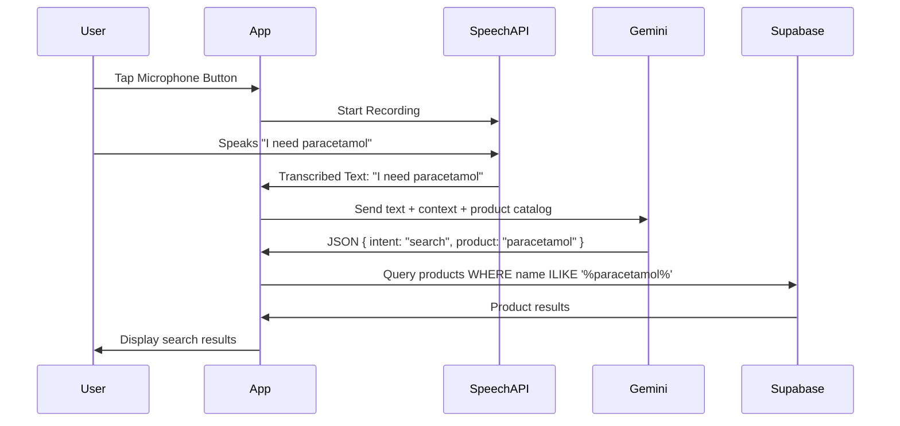

# SilverCart AI Implementation Guide
## Voice Recognition & Natural Language Understanding

**Version:** 1.0  
**Last Updated:** January 30, 2026  
**Project:** SilverCart - Elderly E-Commerce App  
**Target Audience:** Developers implementing voice AI features

---

## Table of Contents

1. [Overview](#overview)
2. [Architecture](#architecture)
3. [Technology Stack](#technology-stack)
4. [Setup & Configuration](#setup--configuration)
5. [Voice Input Implementation](#voice-input-implementation)
6. [Natural Language Understanding](#natural-language-understanding)
7. [Command Parsing & Intent Recognition](#command-parsing--intent-recognition)
8. [Fallback Mechanisms](#fallback-mechanisms)
9. [Error Handling](#error-handling)
10. [Malaysian English Considerations](#malaysian-english-considerations)
11. [Testing Strategy](#testing-strategy)
12. [Performance Optimization](#performance-optimization)
13. [Security & Privacy](#security--privacy)
14. [Troubleshooting](#troubleshooting)
15. [Code Examples](#code-examples)

---

## 1. Overview

### 1.1 Purpose
This guide provides comprehensive instructions for implementing voice recognition and AI-powered natural language understanding in SilverCart, an e-commerce mobile app designed for elderly Malaysians (60+).

### 1.2 Key Features
- **Voice-controlled product search**: Users speak product names naturally
- **Conversational AI**: Natural language understanding with Google Gemini API
- **Cart management via voice**: Add/remove items, check cart contents
- **Checkout assistance**: Voice-guided purchase flow
- **Malaysian English support**: Optimized for local accent and vocabulary

### 1.3 Success Criteria
- Voice recognition accuracy: **>70%**
- Response time: **<3 seconds** from speech end to action
- Fallback to manual search: **<1 second**
- User satisfaction: **>4.0/5.0** (elderly users)

---

## 2. Architecture

### 2.1 High-Level Flow

```
User Speaks → Speech Recognition → Text → NLU/AI → Intent + Entities → App Action → Confirmation
     ↓              ↓                         ↓              ↓               ↓            ↓
  Microphone    Web Speech API         Gemini API     JSON Parser    State Update   UI Feedback
```

### 2.2 System Components

**Frontend (React Native)**
- Voice input capture (microphone button)
- Speech-to-text conversion
- UI feedback (listening animation, transcribed text)
- Action execution (search, cart operations)

**AI Service (Google Gemini API)**
- Natural language understanding
- Intent classification
- Entity extraction (product names, quantities)
- Response generation

**Backend (Supabase)**
- Product catalog search
- Cart state management
- Order processing

**Fallback System**
- Keyword matching (local)
- Manual search interface
- Error recovery flows

### 2.3 Data Flow Diagram



---

## 3. Technology Stack

### 3.1 Voice Recognition

**Primary:** Web Speech API (Browser-based)
- **Pros:** Free, no API keys, low latency, works offline (limited)
- **Cons:** Browser-dependent, limited language customization
- **React Native Integration:** `expo-speech` or `react-native-voice`

**Alternative:** Google Cloud Speech-to-Text API (if Web Speech API fails)
- **Pricing:** 60 minutes/month free, then $0.024/minute
- **Pros:** Better accuracy, more customization
- **Cons:** Requires API key, internet required

### 3.2 Natural Language Understanding

**Primary:** Google Gemini API (Free Tier)
- **Model:** `gemini-1.5-flash` (fast, suitable for real-time)
- **Rate Limits:** 60 requests/minute, 1500 requests/day (free tier)
- **Pricing:** Free tier → Paid ($0.00025/1K characters)

**Alternative:** Groq API (Free, very fast inference)
- **Model:** `llama3-8b-8192` or `mixtral-8x7b-32768`
- **Pros:** Extremely fast (~300 tokens/second), generous free tier
- **Cons:** Less sophisticated NLU than Gemini

**Fallback:** Local keyword matching (regex patterns)
- **Use case:** When API rate limits hit or network fails
- **Accuracy:** ~50% (good enough for common queries)

### 3.3 Dependencies

**React Native:**
```json
{
  "expo-speech": "^11.7.0",
  "react-native-voice": "^3.2.4",
  "@react-native-async-storage/async-storage": "^1.21.0",
  "axios": "^1.6.5"
}
```

**Backend:**
```bash
# Gemini API
npm install @google/generative-ai

# Groq API (alternative)
npm install groq-sdk
```

---

## 4. Setup & Configuration

### 4.1 Google Gemini API Setup

**Step 1: Get API Key**
1. Visit https://makersuite.google.com/app/apikey
2. Click "Create API Key"
3. Copy the key (format: `AIzaSyXXXXXXXXXXXXXXXXXXXXXXXXXXXXXX`)

**Step 2: Store Securely**
```javascript
// .env (never commit to Git)
GEMINI_API_KEY=AIzaSyXXXXXXXXXXXXXXXXXXXXXXXXXXXXXX

// In React Native, use expo-constants
import Constants from 'expo-constants';
const GEMINI_API_KEY = Constants.expoConfig?.extra?.geminiApiKey;
```

**Step 3: Initialize SDK**
```javascript
import { GoogleGenerativeAI } from "@google/generative-ai";

const genAI = new GoogleGenerativeAI(GEMINI_API_KEY);
const model = genAI.getGenerativeModel({ 
  model: "gemini-1.5-flash",
  generationConfig: {
    temperature: 0.3, // Lower = more deterministic
    maxOutputTokens: 500,
    topP: 0.8,
  }
});
```

### 4.2 Web Speech API Setup (React Native)

**Using expo-speech:**
```javascript
import * as Speech from 'expo-speech';

// Check if speech recognition is available
const isAvailable = await Speech.isSpeechRecognitionAvailableAsync();

// Start listening
const options = {
  language: 'en-MY', // Malaysian English
  maxAlternatives: 1,
  continuous: false,
  interimResults: false,
};

Speech.startSpeechRecognitionAsync(options);
```

**Using react-native-voice (more features):**
```javascript
import Voice from '@react-native-voice/voice';

// Setup event listeners
Voice.onSpeechStart = () => console.log('Speech started');
Voice.onSpeechResults = (e) => console.log('Results:', e.value);
Voice.onSpeechError = (e) => console.log('Error:', e.error);

// Start listening
await Voice.start('en-MY'); // Malaysian English
```

### 4.3 Rate Limiting Configuration

**Client-side rate limiter:**
```javascript
class RateLimiter {
  constructor(maxRequests = 60, timeWindow = 60000) {
    this.maxRequests = maxRequests;
    this.timeWindow = timeWindow; // 1 minute in ms
    this.requests = [];
  }

  async canMakeRequest() {
    const now = Date.now();
    // Remove requests older than time window
    this.requests = this.requests.filter(time => now - time < this.timeWindow);
    
    if (this.requests.length >= this.maxRequests) {
      const oldestRequest = this.requests[0];
      const waitTime = this.timeWindow - (now - oldestRequest);
      throw new Error(`Rate limit exceeded. Wait ${Math.ceil(waitTime / 1000)}s`);
    }
    
    this.requests.push(now);
    return true;
  }
}

const geminiRateLimiter = new RateLimiter(60, 60000); // 60 req/min
```

---

## 5. Voice Input Implementation

### 5.1 Microphone Button Component

```javascript
// components/VoiceMicButton.js
import React, { useState } from 'react';
import { TouchableOpacity, View, Text, Animated } from 'react-native';
import Voice from '@react-native-voice/voice';
import { Ionicons } from '@expo/vector-icons';

export default function VoiceMicButton({ onTranscript, onError }) {
  const [isListening, setIsListening] = useState(false);
  const [pulseAnim] = useState(new Animated.Value(1));

  React.useEffect(() => {
    Voice.onSpeechStart = onSpeechStart;
    Voice.onSpeechEnd = onSpeechEnd;
    Voice.onSpeechResults = onSpeechResults;
    Voice.onSpeechError = onSpeechError;

    return () => {
      Voice.destroy().then(Voice.removeAllListeners);
    };
  }, []);

  const onSpeechStart = () => {
    setIsListening(true);
    // Pulse animation
    Animated.loop(
      Animated.sequence([
        Animated.timing(pulseAnim, {
          toValue: 1.2,
          duration: 500,
          useNativeDriver: true,
        }),
        Animated.timing(pulseAnim, {
          toValue: 1,
          duration: 500,
          useNativeDriver: true,
        }),
      ])
    ).start();
  };

  const onSpeechEnd = () => {
    setIsListening(false);
    pulseAnim.stopAnimation();
  };

  const onSpeechResults = (e) => {
    const transcript = e.value[0]; // Best result
    onTranscript(transcript);
  };

  const onSpeechError = (e) => {
    setIsListening(false);
    pulseAnim.stopAnimation();
    onError(e.error);
  };

  const startListening = async () => {
    try {
      await Voice.start('en-MY'); // Malaysian English
    } catch (e) {
      onError(e);
    }
  };

  const stopListening = async () => {
    try {
      await Voice.stop();
    } catch (e) {
      onError(e);
    }
  };

  return (
    <TouchableOpacity
      onPress={isListening ? stopListening : startListening}
      style={{
        width: 100,
        height: 100,
        borderRadius: 50,
        backgroundColor: isListening ? '#FF5722' : '#007A6A',
        justifyContent: 'center',
        alignItems: 'center',
        elevation: 5,
      }}
    >
      <Animated.View style={{ transform: [{ scale: pulseAnim }] }}>
        <Ionicons
          name={isListening ? 'stop' : 'mic'}
          size={48}
          color="#FFFFFF"
        />
      </Animated.View>
      <Text style={{ color: '#FFF', marginTop: 8, fontSize: 14 }}>
        {isListening ? 'Listening...' : 'Tap to Speak'}
      </Text>
    </TouchableOpacity>
  );
}
```

### 5.2 Voice Search Screen

```javascript
// screens/VoiceSearchScreen.js
import React, { useState } from 'react';
import { View, Text, ActivityIndicator } from 'react-native';
import VoiceMicButton from '../components/VoiceMicButton';
import { processVoiceCommand } from '../services/aiService';

export default function VoiceSearchScreen({ navigation }) {
  const [transcript, setTranscript] = useState('');
  const [isProcessing, setIsProcessing] = useState(false);
  const [error, setError] = useState('');

  const handleTranscript = async (text) => {
    setTranscript(text);
    setIsProcessing(true);
    setError('');

    try {
      const result = await processVoiceCommand(text);
      
      if (result.intent === 'search') {
        navigation.navigate('SearchResults', { 
          query: result.product,
          results: result.products 
        });
      } else if (result.intent === 'add_to_cart') {
        // Handle cart addition
        await addToCart(result.product, result.quantity || 1);
        navigation.navigate('Cart');
      } else if (result.intent === 'view_cart') {
        navigation.navigate('Cart');
      }
    } catch (e) {
      setError(e.message);
      // Fallback to manual search
      navigation.navigate('ManualSearch', { query: text });
    } finally {
      setIsProcessing(false);
    }
  };

  const handleError = (errorMsg) => {
    setError(`Voice recognition error: ${errorMsg}`);
  };

  return (
    <View style={{ flex: 1, justifyContent: 'center', alignItems: 'center', padding: 20 }}>
      <Text style={{ fontSize: 32, fontWeight: 'bold', marginBottom: 40 }}>
        Voice Search
      </Text>

      <VoiceMicButton 
        onTranscript={handleTranscript}
        onError={handleError}
      />

      {transcript && (
        <View style={{ marginTop: 30, padding: 15, backgroundColor: '#E0F2F1', borderRadius: 10 }}>
          <Text style={{ fontSize: 18, color: '#333' }}>
            You said: "{transcript}"
          </Text>
        </View>
      )}

      {isProcessing && (
        <View style={{ marginTop: 20 }}>
          <ActivityIndicator size="large" color="#007A6A" />
          <Text style={{ marginTop: 10, fontSize: 16 }}>
            Processing your request...
          </Text>
        </View>
      )}

      {error && (
        <View style={{ marginTop: 20, padding: 15, backgroundColor: '#FFEBEE', borderRadius: 10 }}>
          <Text style={{ fontSize: 16, color: '#C62828' }}>
            {error}
          </Text>
        </View>
      )}
    </View>
  );
}
```

---

## 6. Natural Language Understanding

### 6.1 Gemini API Integration

**Core AI Service:**
```javascript
// services/aiService.js
import { GoogleGenerativeAI } from "@google/generative-ai";
import { getProductCatalog } from './productService';

const genAI = new GoogleGenerativeAI(process.env.GEMINI_API_KEY);
const model = genAI.getGenerativeModel({ model: "gemini-1.5-flash" });

/**
 * Process voice command and extract intent + entities
 * @param {string} transcript - User's spoken text
 * @returns {Promise<Object>} { intent, product, quantity, response }
 */
export async function processVoiceCommand(transcript) {
  try {
    // Get current product catalog for context
    const products = await getProductCatalog();
    const productNames = products.map(p => p.name).join(', ');

    // Construct prompt
    const prompt = `
You are a helpful shopping assistant for SilverCart, an e-commerce app for elderly users in Malaysia.

AVAILABLE PRODUCTS:
${productNames}

USER SAID:
"${transcript}"

TASK:
Analyze the user's intent and extract relevant information.

SUPPORTED INTENTS:
- "search": User wants to find products
- "add_to_cart": User wants to add a product to cart
- "view_cart": User wants to see their cart
- "remove_from_cart": User wants to remove an item
- "checkout": User wants to complete purchase
- "unknown": Cannot determine intent

RESPONSE FORMAT (JSON ONLY):
{
  "intent": "search | add_to_cart | view_cart | remove_from_cart | checkout | unknown",
  "product": "exact product name from available products or null",
  "quantity": 1,
  "confidence": 0.85,
  "response": "Friendly confirmation message for the user"
}

IMPORTANT:
- Match product names flexibly (e.g., "paracetamol" matches "Paracetamol 500mg")
- If product not in catalog, set product to the closest match or null
- Quantity defaults to 1 if not specified
- Response should be friendly and confirm the action
- Return ONLY valid JSON, no markdown or extra text
`;

    // Call Gemini API
    const result = await model.generateContent(prompt);
    const responseText = result.response.text();

    // Parse JSON (remove markdown code blocks if present)
    const jsonText = responseText.replace(/```json\n?/g, '').replace(/```\n?/g, '').trim();
    const parsed = JSON.parse(jsonText);

    // Validate response
    if (!parsed.intent || !parsed.response) {
      throw new Error('Invalid AI response format');
    }

    // If search intent, fetch actual products
    if (parsed.intent === 'search' && parsed.product) {
      const searchResults = await searchProducts(parsed.product);
      parsed.products = searchResults;
    }

    return parsed;
  } catch (error) {
    console.error('AI processing error:', error);
    
    // Fallback to keyword matching
    return fallbackKeywordMatch(transcript);
  }
}
```

### 6.2 Product Search Integration

```javascript
// services/productService.js
import { supabase } from '../config/supabase';

/**
 * Get all products from catalog
 */
export async function getProductCatalog() {
  const { data, error } = await supabase
    .from('products')
    .select('id, name, category, price, stock_status')
    .eq('stock_status', 'in_stock');

  if (error) throw error;
  return data;
}

/**
 * Search products by name (fuzzy matching)
 */
export async function searchProducts(query) {
  const { data, error } = await supabase
    .from('products')
    .select('*')
    .or(`name.ilike.%${query}%,search_keywords.cs.{${query}}`)
    .eq('stock_status', 'in_stock')
    .limit(10);

  if (error) throw error;
  return data;
}

/**
 * Search with alternative spellings/variations
 */
export async function searchProductsFlexible(query) {
  // Common variations for Malaysian English
  const variations = [
    query,
    query.toLowerCase(),
    query.replace(/s$/, ''), // Remove plural
    query.replace(/panadol/i, 'paracetamol'), // Brand to generic
    query.replace(/paracetamol/i, 'panadol'), // Generic to brand
    // Add more variations as needed
  ];

  for (const variant of variations) {
    const results = await searchProducts(variant);
    if (results.length > 0) return results;
  }

  return []; // No matches
}
```

---

## 7. Command Parsing & Intent Recognition

### 7.1 Supported Voice Commands

**Search Commands:**
```javascript
const searchPatterns = [
  "I need {product}",
  "Find {product}",
  "Show me {product}",
  "I want {product}",
  "Do you have {product}?",
  "Search for {product}",
  "I'm looking for {product}",
  "{product} please",
];

// Examples:
// "I need paracetamol" → search(paracetamol)
// "Show me rice" → search(rice)
// "Do you have cooking oil?" → search(cooking oil)
```

**Cart Commands:**
```javascript
const addToCartPatterns = [
  "Add {product} to cart",
  "Add {product}",
  "I want to buy {product}",
  "Put {product} in my cart",
  "Add {quantity} {product}",
];

// Examples:
// "Add paracetamol to cart" → add_to_cart(paracetamol, 1)
// "Add 2 rice" → add_to_cart(rice, 2)
// "Put cooking oil in my cart" → add_to_cart(cooking oil, 1)
```

**Cart Management:**
```javascript
const cartManagementPatterns = [
  "What's in my cart?",
  "Show my cart",
  "View cart",
  "Check cart",
  "My cart",
  "Remove {product}",
  "Delete {product} from cart",
];

// Examples:
// "What's in my cart?" → view_cart()
// "Remove paracetamol" → remove_from_cart(paracetamol)
```

**Checkout:**
```javascript
const checkoutPatterns = [
  "Checkout",
  "Check out",
  "Buy now",
  "Place order",
  "I want to buy",
  "Complete purchase",
];

// Examples:
// "Checkout" → checkout()
// "I want to buy" → checkout()
```

### 7.2 Intent Classification Logic

```javascript
// services/intentClassifier.js

/**
 * Classify user intent from transcript
 * Used as fallback when AI API fails
 */
export function classifyIntent(transcript) {
  const text = transcript.toLowerCase().trim();

  // Checkout intent
  if (/\b(checkout|check out|buy now|place order|complete purchase)\b/i.test(text)) {
    return {
      intent: 'checkout',
      confidence: 0.9,
    };
  }

  // View cart intent
  if (/\b(what'?s in my cart|show my cart|view cart|check cart|my cart)\b/i.test(text)) {
    return {
      intent: 'view_cart',
      confidence: 0.9,
    };
  }

  // Remove from cart
  const removeMatch = text.match(/\b(remove|delete)\s+(.+?)\s*(from cart)?$/i);
  if (removeMatch) {
    return {
      intent: 'remove_from_cart',
      product: removeMatch[2],
      confidence: 0.8,
    };
  }

  // Add to cart
  const addMatch = text.match(/\b(add|put)\s+(\d+\s+)?(.+?)\s*(to|in)\s*(my\s+)?cart\b/i);
  if (addMatch) {
    return {
      intent: 'add_to_cart',
      quantity: parseInt(addMatch[2]) || 1,
      product: addMatch[3],
      confidence: 0.85,
    };
  }

  // Search (default for most queries)
  // Extract product name (everything after trigger words)
  const searchMatch = text.match(/\b(i need|find|show me|i want|do you have|search for|looking for)\s+(.+)/i);
  if (searchMatch) {
    return {
      intent: 'search',
      product: searchMatch[2],
      confidence: 0.8,
    };
  }

  // Fallback: treat entire phrase as search query
  return {
    intent: 'search',
    product: text,
    confidence: 0.5,
  };
}
```

### 7.3 Entity Extraction

```javascript
/**
 * Extract product name and quantity from text
 */
export function extractEntities(text) {
  // Extract quantity
  const quantityMatch = text.match(/\b(\d+)\s+(pieces?|boxes?|packets?|bottles?)?\s+/i);
  const quantity = quantityMatch ? parseInt(quantityMatch[1]) : 1;

  // Extract product name (clean up)
  let product = text
    .replace(/\b(i need|find|show me|i want|add|put|remove|delete)\b/gi, '')
    .replace(/\b(to|in|from|my)\s+(cart|basket)\b/gi, '')
    .replace(/\b(\d+)\s+(pieces?|boxes?|packets?|bottles?)\b/gi, '')
    .replace(/\bplease\b/gi, '')
    .trim();

  return { product, quantity };
}

/**
 * Match user input to product catalog
 */
export function matchProduct(userInput, productCatalog) {
  const input = userInput.toLowerCase();

  // Exact match
  let match = productCatalog.find(p => 
    p.name.toLowerCase() === input
  );
  if (match) return match;

  // Partial match (contains)
  match = productCatalog.find(p => 
    p.name.toLowerCase().includes(input) || 
    input.includes(p.name.toLowerCase())
  );
  if (match) return match;

  // Search keywords match
  match = productCatalog.find(p => 
    p.search_keywords?.some(kw => 
      kw.toLowerCase().includes(input) || 
      input.includes(kw.toLowerCase())
    )
  );
  if (match) return match;

  // Fuzzy match (Levenshtein distance)
  const scored = productCatalog.map(p => ({
    product: p,
    score: levenshteinDistance(input, p.name.toLowerCase()),
  }));

  scored.sort((a, b) => a.score - b.score);

  // Return best match if similarity > 70%
  const bestMatch = scored[0];
  const similarity = 1 - (bestMatch.score / Math.max(input.length, bestMatch.product.name.length));
  
  return similarity > 0.7 ? bestMatch.product : null;
}

/**
 * Calculate Levenshtein distance (edit distance)
 */
function levenshteinDistance(str1, str2) {
  const matrix = [];

  for (let i = 0; i <= str2.length; i++) {
    matrix[i] = [i];
  }

  for (let j = 0; <= str1.length; j++) {
    matrix[0][j] = j;
  }

  for (let i = 1; i <= str2.length; i++) {
    for (let j = 1; j <= str1.length; j++) {
      if (str2.charAt(i - 1) === str1.charAt(j - 1)) {
        matrix[i][j] = matrix[i - 1][j - 1];
      } else {
        matrix[i][j] = Math.min(
          matrix[i - 1][j - 1] + 1, // substitution
          matrix[i][j - 1] + 1,     // insertion
          matrix[i - 1][j] + 1      // deletion
        );
      }
    }
  }

  return matrix[str2.length][str1.length];
}
```

---

## 8. Fallback Mechanisms

### 8.1 Fallback Strategy

**Fallback Hierarchy:**
```
1. Gemini API (primary)
   ↓ (if fails)
2. Groq API (fast alternative)
   ↓ (if fails)
3. Keyword matching (local)
   ↓ (if fails)
4. Manual search UI
```

### 8.2 Keyword Matching Implementation

```javascript
// services/fallbackService.js

/**
 * Fallback to keyword matching when AI API fails
 */
export function fallbackKeywordMatch(transcript) {
  const intent = classifyIntent(transcript);
  const { product, quantity } = extractEntities(transcript);

  return {
    intent: intent.intent,
    product: product,
    quantity: quantity,
    confidence: intent.confidence,
    response: generateFallbackResponse(intent.intent, product),
    fallback: true, // Flag to indicate fallback was used
  };
}

/**
 * Generate user-friendly response for fallback
 */
function generateFallbackResponse(intent, product) {
  const responses = {
    search: `Searching for "${product}"...`,
    add_to_cart: `Adding "${product}" to your cart...`,
    view_cart: `Showing your cart...`,
    remove_from_cart: `Removing "${product}" from cart...`,
    checkout: `Taking you to checkout...`,
    unknown: `I didn't quite catch that. Please try again or use the search button.`,
  };

  return responses[intent] || responses.unknown;
}
```

### 8.3 Graceful Degradation

```javascript
// services/aiService.js (updated with fallback)

export async function processVoiceCommand(transcript) {
  // Try Gemini API first
  try {
    await geminiRateLimiter.canMakeRequest();
    return await processWithGemini(transcript);
  } catch (error) {
    console.warn('Gemini API failed, trying Groq...', error);

    // Try Groq API as backup
    try {
      return await processWithGroq(transcript);
    } catch (groqError) {
      console.warn('Groq API failed, using keyword matching...', groqError);

      // Fallback to local keyword matching
      return fallbackKeywordMatch(transcript);
    }
  }
}
```

---

## 9. Error Handling

### 9.1 Error Types & Handling

```javascript
// utils/errorHandler.js

export class VoiceError extends Error {
  constructor(type, message, recoverable = true) {
    super(message);
    this.type = type;
    this.recoverable = recoverable;
  }
}

// Error types
export const ERROR_TYPES = {
  MICROPHONE_PERMISSION: 'microphone_permission',
  SPEECH_RECOGNITION_UNAVAILABLE: 'speech_recognition_unavailable',
  SPEECH_TIMEOUT: 'speech_timeout',
  NO_SPEECH_DETECTED: 'no_speech_detected',
  NETWORK_ERROR: 'network_error',
  API_RATE_LIMIT: 'api_rate_limit',
  API_ERROR: 'api_error',
  PARSING_ERROR: 'parsing_error',
  PRODUCT_NOT_FOUND: 'product_not_found',
};

/**
 * Handle voice-related errors with user-friendly messages
 */
export function handleVoiceError(error) {
  let userMessage = '';
  let actionable = true;

  switch (error.type) {
    case ERROR_TYPES.MICROPHONE_PERMISSION:
      userMessage = 'Microphone permission denied. Please enable it in Settings.';
      actionable = false;
      break;

    case ERROR_TYPES.SPEECH_RECOGNITION_UNAVAILABLE:
      userMessage = 'Voice recognition is not available on your device. Please use manual search.';
      actionable = false;
      break;

    case ERROR_TYPES.SPEECH_TIMEOUT:
      userMessage = 'No speech detected. Please try again.';
      break;

    case ERROR_TYPES.NO_SPEECH_DETECTED:
      userMessage = 'Could not hear you. Please speak clearly and try again.';
      break;

    case ERROR_TYPES.NETWORK_ERROR:
      userMessage = 'No internet connection. Voice search requires internet.';
      break;

    case ERROR_TYPES.API_RATE_LIMIT:
      userMessage = 'Too many requests. Please wait a moment and try again.';
      break;

    case ERROR_TYPES.API_ERROR:
      userMessage = 'Service temporarily unavailable. Using backup search...';
      break;

    case ERROR_TYPES.PARSING_ERROR:
      userMessage = 'Could not understand your request. Please rephrase or use manual search.';
      break;

    case ERROR_TYPES.PRODUCT_NOT_FOUND:
      userMessage = `Product "${error.product}" not found. Try browsing categories.`;
      break;

    default:
      userMessage = 'Something went wrong. Please try again.';
  }

  return {
    message: userMessage,
    actionable,
    type: error.type,
  };
}
```

### 9.2 Retry Logic

```javascript
/**
 * Retry function with exponential backoff
 */
export async function retryWithBackoff(
  fn,
  maxRetries = 3,
  initialDelay = 1000
) {
  let lastError;

  for (let i = 0; i < maxRetries; i++) {
    try {
      return await fn();
    } catch (error) {
      lastError = error;
      
      if (i < maxRetries - 1) {
        const delay = initialDelay * Math.pow(2, i); // Exponential backoff
        console.log(`Retry ${i + 1}/${maxRetries} after ${delay}ms...`);
        await new Promise(resolve => setTimeout(resolve, delay));
      }
    }
  }

  throw lastError;
}

// Usage
const result = await retryWithBackoff(
  () => processWithGemini(transcript),
  3, // max 3 retries
  1000 // start with 1 second delay
);
```

---

## 10. Malaysian English Considerations

### 10.1 Common Variations

**Product Names:**
```javascript
const malaysianVariations = {
  // Medicine
  'panadol': ['paracetamol', 'fever medicine', 'headache medicine'],
  'flu medicine': ['cold medicine', 'flu tablets', 'selsema medicine'],
  'minyak angin': ['medicated oil', 'cap kapak', 'axe oil'],
  
  // Groceries
  'beras': ['rice', 'nasi'],
  'minyak masak': ['cooking oil', 'minyak'],
  'gula': ['sugar'],
  'garam': ['salt'],
  'kicap': ['soy sauce', 'kicap masin'],
  
  // Common phrases
  'ubat': ['medicine', 'medication'],
  'makanan': ['food', 'groceries'],
};

/**
 * Expand search query with Malaysian variations
 */
export function expandSearchQuery(query) {
  const queries = [query];
  
  for (const [malay, variations] of Object.entries(malaysianVariations)) {
    if (query.toLowerCase().includes(malay)) {
      queries.push(...variations);
    }
    
    for (const variant of variations) {
      if (query.toLowerCase().includes(variant.toLowerCase())) {
        queries.push(malay, ...variations.filter(v => v !== variant));
      }
    }
  }
  
  return [...new Set(queries)]; // Remove duplicates
}
```

### 10.2 Accent Handling

**Speech Recognition Configuration:**
```javascript
// Configure for Malaysian English accent
const speechConfig = {
  language: 'en-MY', // Malaysian English (if available)
  // Fallback to generic English
  fallbackLanguages: ['en-US', 'en-GB', 'en-SG'],
  
  // Adjust recognition parameters for local accent
  maxAlternatives: 3, // Get top 3 alternatives
  continuous: false,
  interimResults: false,
};

/**
 * Post-process speech recognition results for Malaysian English
 */
export function postProcessTranscript(transcript) {
  // Common mis-recognitions
  const corrections = {
    'para sit a mole': 'paracetamol',
    'para c ta mol': 'paracetamol',
    'minute young': 'minyak angin',
    'bear us': 'beras',
    'kee chap': 'kicap',
  };

  let corrected = transcript.toLowerCase();

  for (const [wrong, right] of Object.entries(corrections)) {
    corrected = corrected.replace(new RegExp(wrong, 'gi'), right);
  }

  return corrected;
}
```

### 10.3 Multi-Language Support (Future)

**Bahasa Malaysia Integration:**
```javascript
// Future enhancement: Support Malay commands
const malayCommands = {
  'saya nak': 'I need',
  'cari': 'search',
  'tambah': 'add',
  'buang': 'remove',
  'beli': 'buy',
  'checkout': 'checkout',
};

/**
 * Translate Malay commands to English
 */
export function translateMalayToEnglish(text) {
  let translated = text;

  for (const [malay, english] of Object.entries(malayCommands)) {
    translated = translated.replace(new RegExp(`\\b${malay}\\b`, 'gi'), english);
  }

  return translated;
}
```

---

## 11. Testing Strategy

### 11.1 Unit Tests

**Testing Voice Processing:**
```javascript
// __tests__/aiService.test.js
import { processVoiceCommand, fallbackKeywordMatch } from '../services/aiService';

describe('Voice Command Processing', () => {
  test('should recognize search intent', async () => {
    const result = await processVoiceCommand('I need paracetamol');
    expect(result.intent).toBe('search');
    expect(result.product).toContain('paracetamol');
  });

  test('should recognize add to cart intent', async () => {
    const result = await processVoiceCommand('Add rice to cart');
    expect(result.intent).toBe('add_to_cart');
    expect(result.product).toContain('rice');
  });

  test('should handle quantity', async () => {
    const result = await processVoiceCommand('Add 2 boxes of paracetamol');
    expect(result.quantity).toBe(2);
  });

  test('should fallback to keyword matching on API error', async () => {
    // Mock API failure
    jest.spyOn(global, 'fetch').mockRejectedValue(new Error('API Error'));
    
    const result = await processVoiceCommand('I need paracetamol');
    expect(result.fallback).toBe(true);
    expect(result.intent).toBe('search');
  });
});
```

### 11.2 Integration Tests

```javascript
// __tests__/integration/voiceSearch.test.js
import { render, fireEvent, waitFor } from '@testing-library/react-native';
import VoiceSearchScreen from '../../screens/VoiceSearchScreen';

describe('Voice Search Integration', () => {
  test('complete voice search flow', async () => {
    const { getByTestId, getByText } = render(<VoiceSearchScreen />);

    // Tap microphone button
    const micButton = getByTestId('mic-button');
    fireEvent.press(micButton);

    // Simulate speech recognition result
    // (requires mocking react-native-voice)
    await waitFor(() => {
      expect(getByText(/searching/i)).toBeTruthy();
    });

    // Verify navigation to search results
    await waitFor(() => {
      expect(navigation.navigate).toHaveBeenCalledWith('SearchResults', 
        expect.objectContaining({ query: expect.any(String) })
      );
    });
  });
});
```

### 11.3 User Testing with Elderly Users

**Test Protocol:**
```markdown
## Voice Search User Testing Protocol

### Participants
- 5+ elderly users (60+ years old)
- Mix of genders, tech literacy levels
- Malaysian English speakers

### Test Environment
- Quiet room (minimize background noise)
- Good internet connection
- Fully charged device

### Test Tasks
1. **Task 1: Basic Search**
   - Instruction: "Use voice to search for paracetamol"
   - Success: User finds product and sees results
   - Metrics: Time, accuracy, confidence

2. **Task 2: Add to Cart**
   - Instruction: "Add rice to your cart using voice"
   - Success: Rice added to cart
   - Metrics: Number of attempts, frustration level

3. **Task 3: View Cart**
   - Instruction: "Check what's in your cart using voice"
   - Success: Cart screen displayed
   - Metrics: Recognition accuracy

4. **Task 4: Complex Query**
   - Instruction: "Add 2 bottles of cooking oil"
   - Success: Correct quantity added
   - Metrics: Entity extraction accuracy

5. **Task 5: Error Recovery**
   - Instruction: "Search for a product that doesn't exist"
   - Success: Fallback to manual search gracefully
   - Metrics: User confusion level

### Metrics to Collect
- Task completion rate (%)
- Time to complete (seconds)
- Number of retry attempts
- Voice recognition accuracy (%)
- User satisfaction (1-5 scale)
- Quotes and observations

### Success Criteria
- Task completion rate > 80%
- Voice recognition accuracy > 70%
- User satisfaction > 4.0/5.0
- No frustrated abandonments
```

---

## 12. Performance Optimization

### 12.1 Response Time Optimization

**Caching Strategy:**
```javascript
// services/cacheService.js
import AsyncStorage from '@react-native-async-storage/async-storage';

const CACHE_DURATION = 3600000; // 1 hour in ms

/**
 * Cache product catalog locally
 */
export async function cacheProductCatalog(products) {
  const cacheData = {
    products,
    timestamp: Date.now(),
  };
  await AsyncStorage.setItem('product_catalog', JSON.stringify(cacheData));
}

/**
 * Get cached product catalog
 */
export async function getCachedProductCatalog() {
  const cached = await AsyncStorage.getItem('product_catalog');
  if (!cached) return null;

  const { products, timestamp } = JSON.parse(cached);
  const age = Date.now() - timestamp;

  // Return cached data if less than 1 hour old
  if (age < CACHE_DURATION) {
    return products;
  }

  return null; // Expired
}

/**
 * Cache common AI responses
 */
const aiResponseCache = new Map();

export async function getCachedAIResponse(transcript) {
  const key = transcript.toLowerCase().trim();
  
  if (aiResponseCache.has(key)) {
    const { response, timestamp } = aiResponseCache.get(key);
    const age = Date.now() - timestamp;

    if (age < CACHE_DURATION) {
      return response;
    }
  }

  return null;
}

export async function cacheAIResponse(transcript, response) {
  const key = transcript.toLowerCase().trim();
  aiResponseCache.set(key, {
    response,
    timestamp: Date.now(),
  });
}
```

### 12.2 Parallel Processing

```javascript
/**
 * Process voice command with parallel operations
 */
export async function processVoiceCommandOptimized(transcript) {
  // Start all operations in parallel
  const [
    cachedProducts,
    cachedAIResponse,
  ] = await Promise.all([
    getCachedProductCatalog(),
    getCachedAIResponse(transcript),
  ]);

  // Use cached AI response if available
  if (cachedAIResponse) {
    return cachedAIResponse;
  }

  // Use cached products for faster context
  const products = cachedProducts || await getProductCatalog();
  if (!cachedProducts) {
    cacheProductCatalog(products); // Cache for next time
  }

  // Process with AI
  const result = await processWithGemini(transcript, products);

  // Cache result
  cacheAIResponse(transcript, result);

  return result;
}
```

### 12.3 Bundle Size Optimization

**Lazy Loading AI Models:**
```javascript
// Lazy load Gemini SDK only when needed
let genAI = null;

async function initializeGemini() {
  if (!genAI) {
    const { GoogleGenerativeAI } = await import("@google/generative-ai");
    genAI = new GoogleGenerativeAI(process.env.GEMINI_API_KEY);
  }
  return genAI;
}
```

---

## 13. Security & Privacy

### 13.1 Data Privacy

**Voice Data Handling:**
- **No permanent storage**: Transcripts not saved after processing
- **No cloud uploads**: Audio stays on device (Web Speech API)
- **Encrypted transmission**: All API calls over HTTPS
- **Minimal logging**: Only errors logged, no PII

**Privacy Policy Compliance:**
```javascript
// utils/privacy.js

/**
 * Check if user has consented to voice features
 */
export async function checkVoiceConsent() {
  const consent = await AsyncStorage.getItem('voice_consent');
  return consent === 'true';
}

/**
 * Show voice privacy consent dialog
 */
export async function showVoiceConsentDialog() {
  // Show dialog explaining:
  // - Voice data processed temporarily
  // - Not stored permanently
  // - Used only for search/cart operations
  // - Can disable anytime in settings
  
  const userConsent = await showConsentUI();
  await AsyncStorage.setItem('voice_consent', userConsent.toString());
  return userConsent;
}
```

### 13.2 API Key Security

**Environment Variables:**
```javascript
// DO NOT hardcode API keys
// ❌ BAD
const API_KEY = "AIzaSyXXXXXXXXXXXXXXXXXXXXXXXXXXXXXX";

// ✅ GOOD - Use environment variables
// .env (NEVER commit to Git)
GEMINI_API_KEY=AIzaSyXXXXXXXXXXXXXXXXXXXXXXXXXXXXX

// app.json (for Expo)
{
  "expo": {
    "extra": {
      "geminiApiKey": process.env.GEMINI_API_KEY
    }
  }
}

// Access in code
import Constants from 'expo-constants';
const API_KEY = Constants.expoConfig?.extra?.geminiApiKey;
```

**API Key Rotation:**
```javascript
// Implement key rotation for production
const API_KEYS = [
  process.env.GEMINI_API_KEY_1,
  process.env.GEMINI_API_KEY_2,
  process.env.GEMINI_API_KEY_3,
];

let currentKeyIndex = 0;

export function getActiveAPIKey() {
  return API_KEYS[currentKeyIndex];
}

export function rotateAPIKey() {
  currentKeyIndex = (currentKeyIndex + 1) % API_KEYS.length;
}
```

---

## 14. Troubleshooting

### 14.1 Common Issues

**Issue 1: Speech Recognition Not Working**
```
Symptoms: Microphone button does nothing, no recording
Causes:
- Microphone permission not granted
- Speech recognition unavailable on device
- Web Speech API not supported

Solutions:
1. Check permissions: Settings → App → Microphone
2. Verify device compatibility
3. Fallback to manual search
```

**Issue 2: Low Recognition Accuracy**
```
Symptoms: Incorrect transcriptions, products not found
Causes:
- Background noise
- Fast/unclear speech
- Malaysian accent not recognized well
- Product names too complex

Solutions:
1. Prompt user to speak clearly
2. Use noise cancellation if available
3. Implement post-processing corrections
4. Add more search_keywords to products
5. Show alternative suggestions
```

**Issue 3: AI API Rate Limit Hit**
```
Symptoms: "Too many requests" error
Causes:
- Exceeded 60 requests/minute (Gemini free tier)
- Multiple users testing simultaneously

Solutions:
1. Implement request queuing
2. Show "Please wait" message
3. Fallback to keyword matching automatically
4. Upgrade to paid tier if production
```

**Issue 4: Slow Response Time**
```
Symptoms: >5 second delay from speech to results
Causes:
- Slow internet connection
- API latency
- Large product catalog in prompt

Solutions:
1. Cache product catalog locally
2. Use streaming responses (if supported)
3. Show loading indicators
4. Optimize prompt (reduce tokens)
5. Switch to faster model (Groq)
```

### 14.2 Debugging Tools

**Console Logging:**
```javascript
// Enable verbose logging for debugging
const DEBUG_MODE = __DEV__; // Enable in development only

export function debugLog(category, message, data = null) {
  if (!DEBUG_MODE) return;

  const timestamp = new Date().toISOString();
  console.log(`[${timestamp}] [${category}] ${message}`);
  
  if (data) {
    console.log(JSON.stringify(data, null, 2));
  }
}

// Usage
debugLog('VOICE', 'Speech recognition started');
debugLog('AI', 'Gemini API response', { intent, product });
debugLog('ERROR', 'Failed to process command', error);
```

**Performance Monitoring:**
```javascript
// services/performanceMonitor.js
export class PerformanceMonitor {
  constructor() {
    this.metrics = [];
  }

  start(operation) {
    return {
      operation,
      startTime: Date.now(),
    };
  }

  end(timer) {
    const endTime = Date.now();
    const duration = endTime - timer.startTime;

    this.metrics.push({
      operation: timer.operation,
      duration,
      timestamp: endTime,
    });

    debugLog('PERF', `${timer.operation} took ${duration}ms`);

    // Alert if slow
    if (duration > 3000) {
      console.warn(`⚠️ SLOW OPERATION: ${timer.operation} (${duration}ms)`);
    }

    return duration;
  }

  getAverageDuration(operation) {
    const filtered = this.metrics.filter(m => m.operation === operation);
    if (filtered.length === 0) return 0;

    const sum = filtered.reduce((acc, m) => acc + m.duration, 0);
    return sum / filtered.length;
  }
}

// Usage
const perfMonitor = new PerformanceMonitor();

const timer = perfMonitor.start('voice_to_results');
// ... do voice processing ...
perfMonitor.end(timer);

// Check average performance
const avgDuration = perfMonitor.getAverageDuration('voice_to_results');
console.log(`Average voice processing: ${avgDuration}ms`);
```

---

## 15. Code Examples

### 15.1 Complete Voice Search Implementation

```javascript
// screens/VoiceSearchScreen.js (COMPLETE)
import React, { useState, useEffect } from 'react';
import { View, Text, TouchableOpacity, ActivityIndicator, StyleSheet } from 'react-native';
import Voice from '@react-native-voice/voice';
import { Ionicons } from '@expo/vector-icons';
import { processVoiceCommand } from '../services/aiService';
import { handleVoiceError, ERROR_TYPES } from '../utils/errorHandler';

export default function VoiceSearchScreen({ navigation }) {
  const [isListening, setIsListening] = useState(false);
  const [transcript, setTranscript] = useState('');
  const [isProcessing, setIsProcessing] = useState(false);
  const [error, setError] = useState(null);
  const [aiResponse, setAiResponse] = useState('');

  useEffect(() => {
    // Setup voice recognition listeners
    Voice.onSpeechStart = onSpeechStart;
    Voice.onSpeechEnd = onSpeechEnd;
    Voice.onSpeechResults = onSpeechResults;
    Voice.onSpeechError = onSpeechError;

    // Cleanup
    return () => {
      Voice.destroy().then(Voice.removeAllListeners);
    };
  }, []);

  const onSpeechStart = () => {
    setIsListening(true);
    setError(null);
    setTranscript('');
    setAiResponse('');
  };

  const onSpeechEnd = () => {
    setIsListening(false);
  };

  const onSpeechResults = async (e) => {
    const spokenText = e.value[0];
    setTranscript(spokenText);
    await processCommand(spokenText);
  };

  const onSpeechError = (e) => {
    setIsListening(false);
    
    const error = new VoiceError(
      ERROR_TYPES.SPEECH_RECOGNITION_ERROR,
      e.error.message
    );
    
    const errorInfo = handleVoiceError(error);
    setError(errorInfo.message);
  };

  const processCommand = async (text) => {
    setIsProcessing(true);

    try {
      const result = await processVoiceCommand(text);
      setAiResponse(result.response);

      // Execute action based on intent
      switch (result.intent) {
        case 'search':
          navigation.navigate('SearchResults', {
            query: result.product,
            results: result.products,
          });
          break;

        case 'add_to_cart':
          await addToCart(result.product, result.quantity);
          navigation.navigate('Cart');
          break;

        case 'view_cart':
          navigation.navigate('Cart');
          break;

        case 'checkout':
          navigation.navigate('Checkout');
          break;

        default:
          setError('Sorry, I did not understand that command.');
      }
    } catch (error) {
      const errorInfo = handleVoiceError(error);
      setError(errorInfo.message);
      
      // Fallback to manual search
      if (errorInfo.actionable) {
        navigation.navigate('ManualSearch', { query: text });
      }
    } finally {
      setIsProcessing(false);
    }
  };

  const startListening = async () => {
    try {
      await Voice.start('en-MY');
    } catch (e) {
      console.error('Failed to start voice recognition:', e);
      setError('Could not start voice recognition. Please try again.');
    }
  };

  const stopListening = async () => {
    try {
      await Voice.stop();
    } catch (e) {
      console.error('Failed to stop voice recognition:', e);
    }
  };

  return (
    <View style={styles.container}>
      {/* Header */}
      <View style={styles.header}>
        <TouchableOpacity onPress={() => navigation.goBack()}>
          <Ionicons name="arrow-back" size={32} color="#333" />
        </TouchableOpacity>
        <Text style={styles.title}>Voice Search</Text>
        <View style={{ width: 32 }} />
      </View>

      {/* Microphone Button */}
      <View style={styles.micContainer}>
        <TouchableOpacity
          onPress={isListening ? stopListening : startListening}
          style={[
            styles.micButton,
            isListening && styles.micButtonActive,
          ]}
          disabled={isProcessing}
        >
          <Ionicons
            name={isListening ? 'stop' : 'mic'}
            size={64}
            color="#FFFFFF"
          />
        </TouchableOpacity>

        <Text style={styles.micLabel}>
          {isListening ? 'Listening...' : 'Tap to Speak'}
        </Text>
      </View>

      {/* Transcript Display */}
      {transcript && (
        <View style={styles.transcriptBox}>
          <Text style={styles.transcriptLabel}>You said:</Text>
          <Text style={styles.transcriptText}>"{transcript}"</Text>
        </View>
      )}

      {/* AI Response */}
      {aiResponse && !error && (
        <View style={styles.responseBox}>
          <Ionicons name="checkmark-circle" size={32} color="#2E7D32" />
          <Text style={styles.responseText}>{aiResponse}</Text>
        </View>
      )}

      {/* Processing Indicator */}
      {isProcessing && (
        <View style={styles.processingBox}>
          <ActivityIndicator size="large" color="#007A6A" />
          <Text style={styles.processingText}>Processing your request...</Text>
        </View>
      )}

      {/* Error Display */}
      {error && (
        <View style={styles.errorBox}>
          <Ionicons name="alert-circle" size={32} color="#C62828" />
          <Text style={styles.errorText}>{error}</Text>
          <TouchableOpacity
            style={styles.retryButton}
            onPress={() => setError(null)}
          >
            <Text style={styles.retryButtonText}>Try Again</Text>
          </TouchableOpacity>
        </View>
      )}

      {/* Help Text */}
      <View style={styles.helpBox}>
        <Text style={styles.helpTitle}>Try saying:</Text>
        <Text style={styles.helpItem}>• "I need paracetamol"</Text>
        <Text style={styles.helpItem}>• "Add rice to cart"</Text>
        <Text style={styles.helpItem}>• "Show my cart"</Text>
      </View>
    </View>
  );
}

const styles = StyleSheet.create({
  container: {
    flex: 1,
    backgroundColor: '#FFFFFF',
    padding: 20,
  },
  header: {
    flexDirection: 'row',
    justifyContent: 'space-between',
    alignItems: 'center',
    marginBottom: 40,
  },
  title: {
    fontSize: 28,
    fontWeight: 'bold',
    color: '#333',
  },
  micContainer: {
    alignItems: 'center',
    marginVertical: 40,
  },
  micButton: {
    width: 150,
    height: 150,
    borderRadius: 75,
    backgroundColor: '#007A6A',
    justifyContent: 'center',
    alignItems: 'center',
    elevation: 8,
    shadowColor: '#000',
    shadowOffset: { width: 0, height: 4 },
    shadowOpacity: 0.3,
    shadowRadius: 8,
  },
  micButtonActive: {
    backgroundColor: '#FF5722',
  },
  micLabel: {
    marginTop: 20,
    fontSize: 20,
    color: '#666',
    fontWeight: '600',
  },
  transcriptBox: {
    backgroundColor: '#E0F2F1',
    padding: 20,
    borderRadius: 12,
    marginVertical: 20,
  },
  transcriptLabel: {
    fontSize: 16,
    color: '#666',
    marginBottom: 8,
  },
  transcriptText: {
    fontSize: 22,
    color: '#333',
    fontWeight: '500',
  },
  responseBox: {
    flexDirection: 'row',
    alignItems: 'center',
    backgroundColor: '#E8F5E9',
    padding: 20,
    borderRadius: 12,
    marginVertical: 10,
  },
  responseText: {
    fontSize: 18,
    color: '#2E7D32',
    marginLeft: 12,
    flex: 1,
  },
  processingBox: {
    alignItems: 'center',
    marginVertical: 30,
  },
  processingText: {
    marginTop: 15,
    fontSize: 18,
    color: '#666',
  },
  errorBox: {
    backgroundColor: '#FFEBEE',
    padding: 20,
    borderRadius: 12,
    alignItems: 'center',
    marginVertical: 20,
  },
  errorText: {
    fontSize: 18,
    color: '#C62828',
    textAlign: 'center',
    marginVertical: 12,
  },
  retryButton: {
    backgroundColor: '#C62828',
    paddingHorizontal: 30,
    paddingVertical: 12,
    borderRadius: 8,
    marginTop: 10,
  },
  retryButtonText: {
    color: '#FFFFFF',
    fontSize: 18,
    fontWeight: 'bold',
  },
  helpBox: {
    marginTop: 'auto',
    padding: 20,
    backgroundColor: '#F5F5F5',
    borderRadius: 12,
  },
  helpTitle: {
    fontSize: 18,
    fontWeight: 'bold',
    color: '#333',
    marginBottom: 10,
  },
  helpItem: {
    fontSize: 16,
    color: '#666',
    marginVertical: 4,
  },
});
```

### 15.2 Complete AI Service with Fallbacks

```javascript
// services/aiService.js (COMPLETE)
import { GoogleGenerativeAI } from "@google/generative-ai";
import { getProductCatalog, searchProductsFlexible } from './productService';
import { classifyIntent, extractEntities, matchProduct } from './intentClassifier';
import { 
  getCachedAIResponse, 
  cacheAIResponse,
  getCachedProductCatalog,
  cacheProductCatalog 
} from './cacheService';

const genAI = new GoogleGenerativeAI(process.env.EXPO_PUBLIC_GEMINI_API_KEY);

/**
 * Main function: Process voice command with AI and fallbacks
 */
export async function processVoiceCommand(transcript) {
  console.log('Processing voice command:', transcript);

  // Check cache first
  const cached = await getCachedAIResponse(transcript);
  if (cached) {
    console.log('Using cached AI response');
    return cached;
  }

  // Try Gemini API
  try {
    const result = await processWithGemini(transcript);
    await cacheAIResponse(transcript, result);
    return result;
  } catch (geminiError) {
    console.warn('Gemini API failed:', geminiError);

    // Fallback to local keyword matching
    console.log('Using fallback keyword matching');
    return await fallbackKeywordMatch(transcript);
  }
}

/**
 * Process with Gemini API
 */
async function processWithGemini(transcript) {
  // Get product catalog (cached if possible)
  let products = await getCachedProductCatalog();
  if (!products) {
    products = await getProductCatalog();
    await cacheProductCatalog(products);
  }

  const productNames = products.map(p => `${p.name} (${p.category})`).join('\n');

  const prompt = `
You are a helpful shopping assistant for SilverCart, an e-commerce app for elderly users in Malaysia.

AVAILABLE PRODUCTS:
${productNames}

USER SAID:
"${transcript}"

TASK:
Analyze the user's intent and extract relevant information.

SUPPORTED INTENTS:
- "search": User wants to find products
- "add_to_cart": User wants to add a product to cart
- "view_cart": User wants to see their cart
- "remove_from_cart": User wants to remove an item
- "checkout": User wants to complete purchase
- "unknown": Cannot determine intent

IMPORTANT RULES:
1. Match product names flexibly (e.g., "panadol" = "Paracetamol 500mg")
2. Handle Malaysian English variations
3. Extract quantity if mentioned (default = 1)
4. Be forgiving with spelling/pronunciation errors
5. If product not in catalog, suggest closest match

RESPONSE FORMAT (JSON ONLY, NO MARKDOWN):
{
  "intent": "search",
  "product": "Paracetamol 500mg",
  "quantity": 1,
  "confidence": 0.9,
  "response": "Searching for Paracetamol 500mg..."
}

Return ONLY valid JSON with no additional text, code blocks, or formatting.
`;

  const model = genAI.getGenerativeModel({ 
    model: "gemini-1.5-flash",
    generationConfig: {
      temperature: 0.2,
      maxOutputTokens: 500,
    }
  });

  const result = await model.generateContent(prompt);
  const responseText = result.response.text();

  // Clean response (remove markdown code blocks if present)
  const jsonText = responseText
    .replace(/```json\n?/g, '')
    .replace(/```\n?/g, '')
    .trim();

  const parsed = JSON.parse(jsonText);

  // Validate required fields
  if (!parsed.intent || !parsed.response) {
    throw new Error('Invalid AI response format');
  }

  // If search intent, fetch actual products
  if (parsed.intent === 'search' && parsed.product) {
    const searchResults = await searchProductsFlexible(parsed.product);
    parsed.products = searchResults;
    
    if (searchResults.length === 0) {
      parsed.response = `Sorry, I couldn't find "${parsed.product}". Try browsing categories instead.`;
    }
  }

  return parsed;
}

/**
 * Fallback to keyword matching when AI fails
 */
async function fallbackKeywordMatch(transcript) {
  const intent = classifyIntent(transcript);
  const { product, quantity } = extractEntities(transcript);

  let products = [];
  if (intent.intent === 'search' && product) {
    products = await searchProductsFlexible(product);
  }

  return {
    intent: intent.intent,
    product: product,
    quantity: quantity,
    confidence: intent.confidence,
    response: generateFallbackResponse(intent.intent, product),
    products: products,
    fallback: true,
  };
}

/**
 * Generate response for fallback mode
 */
function generateFallbackResponse(intent, product) {
  const responses = {
    search: product ? `Searching for "${product}"...` : 'What would you like to search for?',
    add_to_cart: product ? `Adding "${product}" to your cart...` : 'What would you like to add?',
    view_cart: 'Showing your cart...',
    remove_from_cart: product ? `Removing "${product}"...` : 'What would you like to remove?',
    checkout: 'Taking you to checkout...',
    unknown: 'Sorry, I didn\'t understand. Please try again or use manual search.',
  };

  return responses[intent] || responses.unknown;
}
```

---

## 16. Deployment Checklist

### Pre-Launch Checklist

**API Configuration:**
- [ ] Gemini API key configured in production environment
- [ ] API key rotation strategy in place
- [ ] Rate limiting tested and verified
- [ ] Fallback mechanisms tested

**Voice Recognition:**
- [ ] Tested on Android devices (Samsung, Xiaomi)
- [ ] Tested on iOS devices (iPhone 8+)
- [ ] Malaysian English accent tested with 5+ users
- [ ] Background noise handling tested
- [ ] Microphone permissions handled gracefully

**Performance:**
- [ ] Average response time < 3 seconds
- [ ] Voice recognition accuracy > 70%
- [ ] App size optimized (< 50MB)
- [ ] Caching working correctly

**User Experience:**
- [ ] Error messages user-friendly
- [ ] Loading indicators visible
- [ ] Success confirmations clear
- [ ] Help text accessible
- [ ] Tutorial screens completed

**Security:**
- [ ] No API keys in Git repository
- [ ] HTTPS used for all API calls
- [ ] Voice data not stored permanently
- [ ] Privacy policy implemented

**Testing:**
- [ ] Unit tests passing (> 80% coverage)
- [ ] Integration tests passing
- [ ] User testing completed (5+ elderly users)
- [ ] Edge cases handled (no internet, API failure, etc.)

---

## Conclusion

This guide provides a complete implementation roadmap for voice recognition and AI-powered natural language understanding in SilverCart. Follow the sections sequentially for best results, and refer to the code examples for production-ready implementations.

**Key Takeaways:**
1. **Use Gemini API** for primary NLU (free tier sufficient for MVP)
2. **Implement fallbacks** for reliability (keyword matching when API fails)
3. **Optimize for elderly users** (clear feedback, large buttons, simple language)
4. **Test with real users** (Malaysian elderly, 60+ years old)
5. **Monitor performance** (cache, parallel processing, lazy loading)

**Next Steps:**
1. Set up Gemini API account
2. Implement voice input component
3. Integrate AI service
4. Test with elderly users
5. Iterate based on feedback

For questions or issues, refer to the Troubleshooting section or consult the project supervisor.

---

**Document Version:** 1.0  
**Last Updated:** January 30, 2026  
**Maintained by:** SilverCart Development Team
